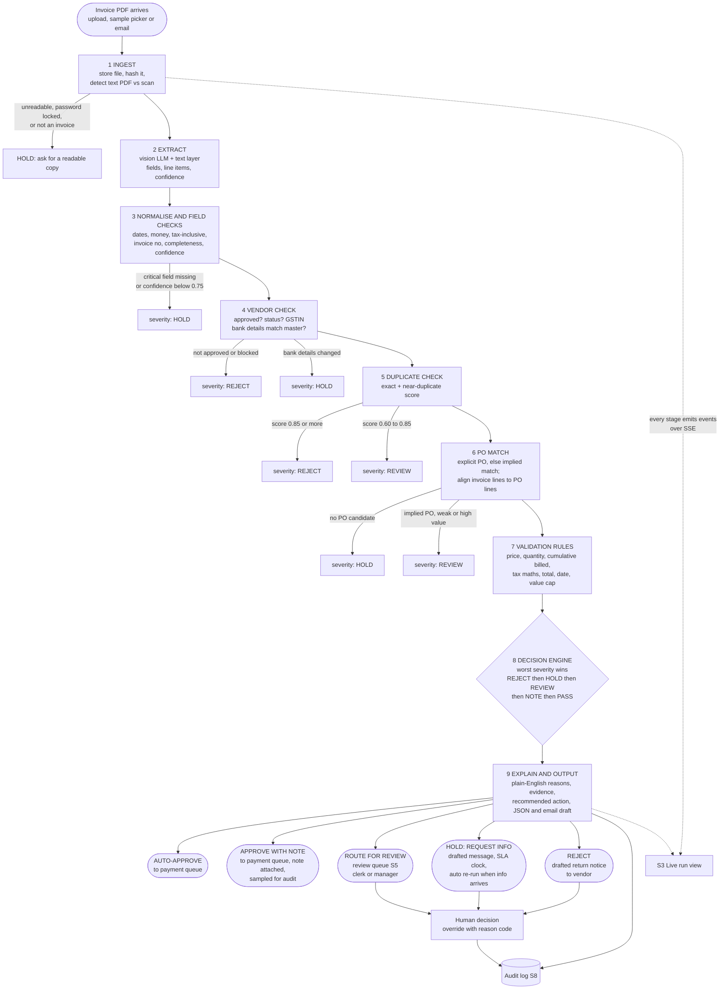
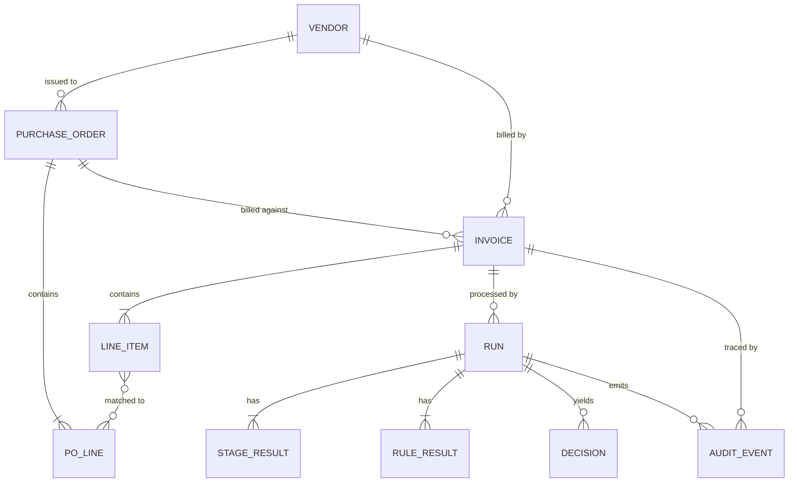
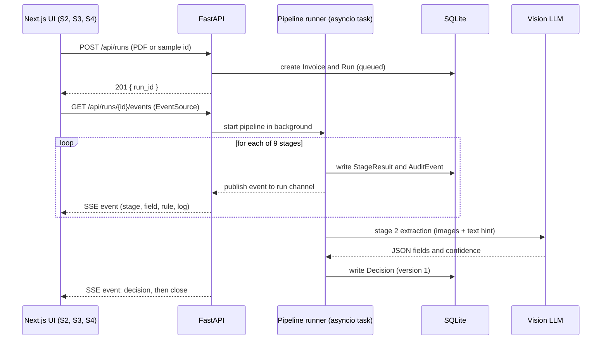

# Ledgerlight: Product Spec

**AI invoice processing for Accounts Payable. Invoice in. Explained decision out. Every step visible.**

Version 1.0 | 16 Nov 2026 | Status: build-ready | Audience: designer (builds every screen from this), builder (builds and demos the real product), and the non-technical buyer reading along.

All vendors, GSTINs, bank accounts, POs and people in this document are fictional. Currency is Indian rupees (₹) with GST, because the sample data is easiest to make realistic that way; every rule is currency-agnostic (see assumption A2).

---

## Contents

1. Problem framing and personas
2. End-to-end process map
3. Decision outcomes and rule logic
4. The four edge cases
5. Feature list by priority
6. Screen-by-screen inventory (S1 to S8)
7. Data model
8. Recommended stack and real-time design
9. Sample data plan
10. Five-minute demo script
11. Assumptions, risks and open questions

## Spec at a glance

| Item | Decision |
|---|---|
| Product | Ledgerlight |
| What it does | Reads a vendor invoice PDF, matches it to the right purchase order, runs 16 checks, and returns one of five decisions with a plain-English reason |
| Decisions | Auto-approve, Approve with note, Route for review, Hold (request info), Reject |
| Core idea | **The AI reads. Rules decide. Everyone can see why.** The language model only turns the PDF into structured fields and polishes wording. Every money decision is made by deterministic, auditable rules |
| Screens | S1 Dashboard, S2 New run, S3 Live run view, S4 Invoice decision detail, S5 Review queue, S6 PO and vendor master data, S7 Rules and tolerances, S8 Audit log |
| Edge cases | EC1 PO split across three invoices (cumulative overbilling), EC2 re-scanned duplicate with a different invoice number, EC3 scanned low-confidence invoice with no PO number, EC4 vendor bank-detail change |
| Build | Next.js + FastAPI + SQLite + vision LLM, Server-Sent Events for the live view, 5 days |

---

## 1. Problem framing and personas

### 1.1 Executive summary

We are building **Ledgerlight** for **AP clerks and AP managers at mid-size companies** to solve the problem that **every vendor invoice is opened, matched to a PO in a spreadsheet, checked by eye and decided by hand**, which is slow, repetitive and error-prone. Ledgerlight takes the PDF, extracts the facts with a confidence score on each one, validates them against vendor and PO master data, and returns a **decision with an explanation a non-accountant can read**. We expect it to take the majority of invoices to a decision with no human touch, and to put the rest in front of the right person with the evidence already assembled.

### 1.2 Problem statement

**Who has the problem.** A mid-size company (assumed 300 to 600 invoices a month, 3 to 6 AP staff) that receives vendor invoices as email PDFs.

**What the problem is.** For each invoice, a clerk opens the PDF, finds the vendor and PO reference, searches a PO spreadsheet, compares line items, quantities, prices, tax and total, checks whether the PO was already partly billed, and decides. Invoices are inconsistent:

- different vendor layouts, and clean text PDFs versus scanned or photographed images
- itemised versus bundled lines, tax-inclusive versus tax-separate pricing
- PO reference written clearly, buried in a description, or missing
- sometimes no invoice number, date or total at all
- one PO billed across several invoices; amounts that are close but not identical; the same invoice sent twice in a different format

**Why it hurts.**

| Impact | Description |
|---|---|
| Time | Each invoice takes an assumed 8 to 12 minutes of looking, copying and checking. Most of that is mechanical lookup, not judgement |
| Money | Overbilling past the PO, duplicate payments and unnoticed bank-detail changes are paid because the check depends on a tired person remembering the spreadsheet |
| Trust | When a clerk rejects or holds an invoice, the vendor asks "why?" and the clerk has to reconstruct the reasoning from memory |
| Delay | Exceptions sit in inboxes. Nobody can say how many invoices are stuck or why |

[ASSUMPTION] The time, volume and error figures above are planning assumptions, not measured data. They are used only to size the benefit (see section 11, A1). The problem statement PS-1 describes the behaviour qualitatively; the numbers are ours.

### 1.3 Personas

**Primary: Priya Nair, AP Clerk (daily user).**

| | |
|---|---|
| Role | Processes 20 to 40 invoices a day |
| Tech comfort | High in Excel and the ERP, low tolerance for "AI magic" she cannot verify |
| Goal | Clear the inbox accurately without being the person who paid a duplicate |
| Pains | Hunting for the PO; re-checking tax by calculator; not knowing if a PO was already partly billed; writing "why I held this" emails |
| What she needs from Ledgerlight | The extracted fields next to the PDF, the PO and the arithmetic done for her, and a decision she can accept in one click or challenge in two |
| Job to be done | "When an invoice lands, help me know in seconds whether it is safe to pay, and if not, exactly what is wrong." |

**Primary: Rahul Mehta, AP Manager and approver (decides exceptions, owns the numbers).**

| | |
|---|---|
| Role | Approves exceptions, owns tolerance policy, answers to the Finance Controller and auditors |
| Goal | Fewer exceptions reaching him, and the ones that do come with a recommendation; a defensible audit trail |
| Pains | Exceptions arrive as forwarded emails with no context; cannot see queue age or cause; audit requests mean digging |
| What he needs | A review queue ranked by risk and age, a clear recommended action, override with a recorded reason, and a dashboard he can show his boss |
| Job to be done | "When an invoice is outside policy, give me the evidence and a recommendation so I can decide in a minute and show later why I did." |

**Buyer (economic buyer, not a daily user): Meera Rao, Finance Controller.** Cares about cost per invoice, duplicate and overbilling leakage prevented, audit readiness and not adding fraud risk. She will judge the product on the Dashboard (S1) and the audit trail (S8). Everything on S1 must be readable by her in ten seconds without a briefing.

**Supporting roles (no dedicated screens beyond master data):** a Procurement owner who maintains POs, vendors and tolerance policy (S6, S7); the vendor, who receives the explanation when an invoice is held or rejected (Ledgerlight drafts the email; it never sends).

### 1.4 Journey map: one invoice, today versus with Ledgerlight

Persona mapped: Priya (AP clerk). Scenario: a vendor invoice arrives by email and must reach a payment decision. The skill's generic stages are adapted to the AP workflow.

| | 1. Receive | 2. Find the PO | 3. Check the numbers | 4. Decide | 5. Resolve exception | 6. Record and report |
|---|---|---|---|---|---|---|
| **Customer actions (today)** | Opens email, saves PDF, renames file | Reads PO ref (or guesses), searches the PO spreadsheet | Compares lines, prices, qty; calculates tax and total; checks prior billing | Approves, or writes a note in a tracker | Emails vendor or procurement, waits | Updates tracker; manager asks for a monthly summary |
| **Touchpoints** | Shared inbox, PDF viewer | PO spreadsheet, ERP | Calculator, spreadsheet | ERP approval, tracker | Email, phone | Spreadsheet, audit folder |
| **Experience** | Dreads the pile; messy scans cause groans | Anxious: "is this the right PO?" | Tedious, easy to miscalculate | Uneasy: "did I miss a duplicate?" | Frustrated by waiting, defensive with vendor | Rushed; reasoning is lost |
| **With Ledgerlight** | Drops the PDF (or picks a sample). Run starts instantly | PO resolved automatically; implied matches shown with a score | All maths shown line by line, pass or fail | Decision card with reasons; one-click accept | Review queue arrives pre-assembled with a recommendation and a drafted vendor email | Audit trail and dashboard write themselves |
| **KPIs** | Time to first decision under 60 s | PO resolved automatically on 95% of invoices | Wrong-tax and variance catches | Straight-through rate 60% or higher | Median exception age under 1 business day | 100% of decisions have a stored explanation |
| **Business goal** | Remove inbox triage | Remove spreadsheet lookup | Remove manual arithmetic | Fewer touches per invoice | Faster, better-documented exceptions | Audit readiness |
| **Teams involved** | AP | AP, Procurement | AP | AP, AP manager | AP, Procurement, vendor | AP manager, Finance Controller, auditors |

**Biggest opportunities.** (1) Stage 2 and 3 are pure lookup and arithmetic and are fully automatable. (2) Stage 5 is where time and goodwill are lost, so Ledgerlight must make exceptions self-explaining. (3) Stage 6 is free once decisions are structured.

### 1.5 Product principles

1. **The AI reads, rules decide.** The LLM extracts and phrases. It never decides money. A reviewer can trace any decision to named rules and numbers.
2. **Explain in the reader's language.** "The vendor billed 500 more cartons than we ordered" beats "Qty variance 5.0% exceeds tolerance".
3. **Show your work, live.** Each stage is visible as it runs, with its inputs and outputs.
4. **Be conservative where fraud lives.** Duplicate and bank-detail risks are never auto-approved, and a human override of them is a manager-only action.
5. **Never silent.** Every automated decision, human override, setting change and master-data edit is written to the audit log.
6. **Run every stage even after a failure.** Complete the picture ("it is a duplicate and it would also exceed the PO") so the explanation is full.

### 1.6 Success metrics

| Type | Metric | Target (for the demo dataset and a real pilot) |
|---|---|---|
| Primary | **Straight-through rate**: share of invoices ending as Auto-approve or Approve with note with no human touch | 60% or more on realistic mixes. Demo history seeded at about 70% |
| Secondary | Median time from upload to decision | Under 30 seconds (versus assumed 8 to 12 minutes of manual work) |
| Secondary | Exceptions delivered with a recommendation and evidence | 100% |
| Secondary | Value protected: ₹ of duplicates blocked plus overbilling caught | Shown on S1 as a running total |
| Guardrail | Wrongly auto-approved invoices found in a 10% sample audit of Approve-with-note | Zero tolerance for fraud classes (duplicate, bank change); under 1% for others |
| Guardrail | Reviewer overrides of "Reject" or "Hold" that are later reversed | Tracked; a rising rate signals mis-tuned rules |

Measurement honesty: in the take-home, "time saved" is computed from the run duration versus a configurable manual baseline (default 9 minutes per invoice). It is labelled "estimated".

---

## 2. End-to-end process map

### 2.1 Process diagram



Reading guide for the designer: the vertical spine is the pipeline. Side exits are the points where a stage can raise a severity. They do **not** stop the pipeline (principle 6); the later stages still run so the explanation is complete. The final decision is made once, at stage 8.

### 2.2 Stage table: inputs, outputs and decision points

| # | Stage | Input | Output | Decision point | Engine |
|---|---|---|---|---|---|
| 1 | Ingest | PDF (upload, sample, or email attachment) | Stored file, SHA-256 hash, page count, page PNGs, `doc_type` = text or scanned (fewer than 50 text characters per page means scanned) | Is it a readable PDF that looks like an invoice? If not, severity HOLD and a "send a readable copy" draft. Same hash seen before feeds stage 5 | Deterministic (PyMuPDF) |
| 2 | Extract | Page images plus text layer (if any) | Structured JSON: header fields, line items, tax lines, bank block, PO reference candidates. Each field has `value`, `raw_text`, `model_confidence`, `found_in_text_layer` | None; this stage reports, it does not judge | Vision LLM with a JSON schema |
| 3 | Normalise and field checks | Raw extraction | Canonical invoice: ISO dates, money as integer paise, invoice number canonical form, tax-inclusive flag resolved to a pre-tax base, unit-of-measure mapped, **effective confidence** per field (see 2.3) | Rules R01 (required fields), R02 (confidence), R03 (date sanity) | Deterministic |
| 4 | Vendor check | Vendor name, GSTIN, bank block | `vendor_id` or none, match method and score, status, bank match result | R04 (approved and active), R05 (bank details match) | Deterministic plus fuzzy match |
| 5 | Duplicate check | Canonical invoice, history | Duplicate score 0 to 1, the closest prior invoice, which signals fired | R06 | Deterministic |
| 6 | PO match | Canonical invoice, PO master | Resolved PO (explicit or implied, with score and runner-up), line alignment table (invoice line to PO line, method, score), cumulative position per PO line | R07 (PO resolved), R08 (PO status), R09 (every line maps to a PO line) | Deterministic plus fuzzy match |
| 7 | Validation rules | Aligned lines, PO position, config | One `RuleResult` per rule with severity, numbers and a plain-English message | R10 to R16 (price, quantity, cumulative value, tax, total, currency, value cap) | Deterministic |
| 8 | Decision | All rule results | Decision (one of five), driving rules, risk exposure in ₹ | Worst severity wins (section 3.1) | Deterministic |
| 9 | Explain and output | Decision, rule results, evidence | Explanation (headline, passed checks, concerns with numbers, next step), recommended action, routing, exportable JSON, vendor email draft | Explanation uses only facts from rule results. LLM may polish wording; if it fails or contradicts facts, the template text is used | Template plus LLM polish |

### 2.3 Key logic, specified

**Effective confidence (stage 3).** LLM self-reported confidence is poorly calibrated, so each extracted field gets an *effective confidence* from independent evidence:

```
effective = 0.50 * model_confidence
          + 0.30 * evidence        (1.0 value found verbatim in text layer or OCR tokens;
                                    0.5 found with minor differences; 0.0 not found)
          + 0.20 * format_valid    (1.0 passes format check: date parses, amount parses,
                                    GSTIN pattern, PO pattern; else 0.0)
```

Two refinements:

- **Reconciliation boost.** If subtotal plus tax equals total exactly (and lines sum to subtotal), the confidence of total, subtotal and tax amounts is raised to at least 0.90. Independent arithmetic agreement is stronger evidence than a blurry glyph. The UI shows both: "0.78, raised to 0.92 because the numbers add up".
- **Self-consistency (scanned PDFs).** Extract twice (different prompt order). A field where the two runs disagree is capped at 0.60.

A field is **critical** if the decision depends on it: vendor identity, invoice number, invoice date, total, currency, PO reference (when present), line amounts.

**Normalisation rules.**

- Dates: parse day-first (India) by default. If both orderings are valid (for example 12/11/26), keep the day-first reading, set an `ambiguous_date` flag and cap that field's confidence at 0.80. Date must also be on or after the PO date and not in the future (R03).
- Money: integer paise; Indian grouping and decimal commas handled; reject nothing silently.
- Tax inclusive: if the invoice shows "inclusive of GST" or only a gross total with a GST rate, back-calculate `base = round(total / (1 + rate), 2)` and mark `tax_inclusive = true`.
- Invoice number canonical form: uppercase, strip spaces and punctuation, keep the vendor prefix, store the *serial token* (the longest digit run that is not the issue year in 2 or 4-digit form, leading zeros stripped). Example: `BL/2026/0377` has serial token `377`; `BL-0377-26` also has serial token `377`.
- Line items: unit-of-measure aliases (kg, kgs, KG; nos, pcs, units, ea); descriptions lower-cased and de-noised for matching.

**Vendor check (R04, R05).**

- Match order: exact GSTIN, then exact normalised name, then fuzzy name (token-set ratio of 0.85 or more). GSTIN match is decisive. Fuzzy-only match without a GSTIN match is severity REVIEW ("looks like Brightline, please confirm").
- Status: Approved passes. Pending onboarding gives HOLD. Blocked or not found gives REJECT.
- Bank: compare account number and IFSC from the invoice to the vendor master. No bank block on the invoice means "not applicable" (pass). Any mismatch, or a footer that says bank details have changed, gives HOLD with a verification checklist (EC4).

**Duplicate score (R06).** Same vendor is a prerequisite (otherwise score is 0). Immediate Reject if the file hash matches a prior file, or the vendor plus canonical invoice number match a prior non-rejected invoice. Otherwise:

| Signal | Weight | How it scores |
|---|---|---|
| Total amount equal | 0.30 | 1.0 if within ₹1; 0.5 if within 0.5%; else 0 |
| Invoice number similarity | 0.25 | 1.0 same prefix and same serial token; 0.8 same serial token, different prefix; else Levenshtein ratio of canonical forms, scaled to a maximum of 0.7 |
| Invoice date | 0.15 | 1.0 same date; 0.5 within 14 days; else 0 |
| Same PO reference | 0.10 | 1.0 same, else 0 |
| Line-item fingerprint equal | 0.20 | 1.0 same multiset of (normalised description, qty, unit price); partial credit by overlap |

Thresholds: **0.85 or more is a duplicate (Reject)**; **0.60 to under 0.85 is "possible duplicate" (Review, side-by-side compare)**; under 0.60 passes. *Recurring-charge guard:* if serial tokens differ by exactly the billing cadence (monthly rent, retainers) and the service period differs, the invoice-number and date signals are not penalised toward duplicate. This prevents flagging genuine monthly invoices of equal amount.

**PO resolution (R07).**

1. **Explicit.** A PO reference matching the master (after normalising spaces, hyphens, case) and belonging to the matched vendor. The normaliser also recognises reordered forms in free text (for example "your PO 1002/2026" resolves to PO-2026-1002 by serial plus year). Done.
2. **Implied.** No PO reference, or one that matches nothing. Score every *open* PO of the matched vendor:

```
implied_score = 0.35 * line_description_similarity   (rapidfuzz token-set, best match per invoice line, averaged)
              + 0.30 * unit_price_agreement           (share of lines whose unit price is within 2% of a PO line)
              + 0.15 * quantity_fits_remaining        (share of lines where qty <= remaining qty)
              + 0.10 * total_fits_remaining           (1 if invoice pre-tax <= PO remaining value)
              + 0.10 * date_within_PO_window          (1 if PO date <= invoice date <= PO valid-to)
```

   Accept an implied PO only if the top score is **0.90 or more and the runner-up is at least 0.20 lower**. Severity then: NOTE if gross total is at most ₹1,00,000, otherwise REVIEW. Below those conditions: REVIEW with the top three candidates and scores shown (if the best score is at least 0.50), else HOLD (no plausible PO).
3. **Explicit but wrong.** PO exists but belongs to a different vendor: REVIEW. PO reference not found at all and implied matching also fails: HOLD.

Why implied matching is allowed to approve at all: PS-1 says the PO reference may be "explicit or implied", and refusing every invoice without a PO number would send a large share of real invoices to humans for a lookup the machine can do reliably. The score, runner-up gap and value ceiling keep the risk bounded.

**Line alignment (R09).** For each invoice line, in order: (a) exact SKU or item code match; (b) fuzzy description match at 0.80 or more with quantity or price corroboration; (c) **bundle match**: if the invoice has fewer lines than the PO and one invoice line's description covers the tokens of several PO lines, compare at group level (invoice amount versus sum of the covered PO lines, quantity per component). An invoice line with no match is "unordered": REVIEW if up to 10% of the invoice pre-tax value, REJECT above 10%.

**Cumulative position (R11, R12).** For each PO line: `ordered_qty`, `billed_qty` (sum of quantities on prior invoices against this PO line whose decision is not Reject, and including Held or Review invoices as "pending" shown separately), `remaining_qty = ordered - billed`. The same at PO value level on a pre-tax basis. This is what makes the third invoice of a split PO visible (EC1).

### 2.4 Decision points summary (for the designer to surface in the UI)

| Decision point | Stage | Question it answers | Visible as |
|---|---|---|---|
| D1 Readable? | 1 | Can we even read this file? | Stage card badge |
| D2 Complete and confident? | 3 | Do we have the fields we need, and do we trust them? | Per-field confidence chips |
| D3 Known and trusted vendor? | 4 | Is this an approved vendor, with the usual bank details? | Vendor card |
| D4 Seen before? | 5 | Is this the same invoice again? | Duplicate gauge with closest match |
| D5 Which PO? | 6 | Explicit, or inferred, and how sure are we? | PO match panel |
| D6 Do the numbers agree? | 7 | Price, quantity, cumulative, tax and total | Rule checklist |
| D7 Overall verdict | 8 | Worst severity wins | Decision card |

### 2.5 Stage timing targets

Ingest under 1 s; extraction 4 to 12 s (LLM); everything after extraction under 2 s combined. The live view enforces a minimum visible dwell of 600 ms per stage so fast stages are still watchable, and marks the dwell as "display pacing" in the log so nothing is misleading.

---

## 3. Decision outcomes and rule logic

### 3.1 How a decision is made

Every rule returns one severity. Severities are ordered:

```
PASS (0)  <  NOTE (1)  <  REVIEW (2)  <  HOLD (3)  <  REJECT (4)
```

**The decision is the worst severity across all rules** (REJECT beats HOLD beats REVIEW beats NOTE beats PASS), mapped as:

| Worst severity | Decision |
|---|---|
| PASS only | **Auto-approve** |
| NOTE | **Approve with note** |
| REVIEW | **Route for review** |
| HOLD | **Hold: request info** |
| REJECT | **Reject** |

Why REJECT outranks HOLD: if an invoice is definitively unpayable (duplicate, blocked vendor), there is no point chasing missing information. Why HOLD outranks REVIEW: a human cannot sensibly review what is incomplete or unverified (for example a changed bank account).

**Hard stops.** A REJECT from R04 (vendor), R06 (duplicate) and a HOLD from R05 (bank change) can be overridden only by an AP manager, and R05 only after the verification checklist is ticked.

### 3.2 The five outcomes

| Outcome | Meaning in plain words | Exact trigger | Where it goes | Who acts | Target time |
|---|---|---|---|---|---|
| **Auto-approve** | Everything checks out. Safe to pay | Every rule PASS | Payment queue | Nobody | Instant |
| **Approve with note** | Safe to pay, but something small is worth remembering | Worst severity NOTE (for example price +1.5%, within the allowed 2%; PO inferred with 96% confidence) | Payment queue, note attached. 10% of these are flagged for a monthly audit sample | Nobody (note is visible on S1 and S4) | Instant |
| **Route for review** | A person with context needs to decide. The evidence is attached | Worst severity REVIEW | Review queue S5. Assigned to **clerk** if financial exposure is up to ₹10,000, to **manager** if above, or if R15 fired | Clerk or manager | Same business day |
| **Hold: request info** | We cannot decide yet because information is missing, unclear or unverified | Worst severity HOLD | Hold list in S5, with a drafted message to the vendor or requester and a 3-business-day SLA clock. Uploading a corrected or additional document re-runs the pipeline | Clerk (chase), manager for bank changes | 3 business days then auto-escalates to manager |
| **Reject** | Do not pay this invoice as it stands | Worst severity REJECT | Rejected list in S5, with a drafted return notice that states the reason and what the vendor must send | Clerk sends notice; manager may overturn | Notice same day |

Financial exposure (₹) is the amount that would be wrongly paid if the invoice were approved as is (for example the overbilled value, the duplicate amount, the whole total for an unverified bank change). It is shown on every exception card.

### 3.3 Variance bands (used by price, quantity and cumulative rules)

One banding scheme is used everywhere so the policy is easy to explain and to tune. `Δ` is invoice minus PO (or minus remaining), `Δ%` is Δ divided by the PO figure.

| Band | Condition (overbilling) | Severity |
|---|---|---|
| Exact enough | abs(Δ%) up to 0.5%, or abs(Δ) up to ₹50 | PASS |
| Within allowed difference | up to 2.0% **and** up to ₹5,000 | NOTE |
| Needs a human | up to 10%, or up to 2% but above ₹5,000 | REVIEW |
| Different transaction | above 10% | REJECT |

For **undercharges** (invoice below PO) the severity is capped at NOTE until −10%, and REVIEW beyond that (it can mean partial delivery or a missing credit). For **quantities**, `Δ` is quantity over what remains on the PO line, and the percentage is taken on the ordered quantity.

### 3.4 Rule catalogue

Each rule is a row in the S7 settings screen with the same IDs. "Stage" is where it runs.

| ID | Rule | Stage | Logic and thresholds | Severities |
|---|---|---|---|---|
| R01 | Required fields present | 3 | Invoice number, invoice date, vendor, total and currency must each have a value | Any missing: HOLD (draft asks the vendor for the missing item) |
| R02 | Extraction confidence | 3 | Each critical field's effective confidence: 0.90 or more is fine; 0.75 to under 0.90 is shown amber; under 0.75 is untrustworthy. Applied after the reconciliation boost | All critical at 0.90 or more: PASS. Lowest between 0.75 and 0.90: NOTE. Lowest under 0.75: HOLD |
| R03 | Invoice date sanity | 3 | Not in the future; not before the PO date; not older than 180 days | Future date: HOLD. Before PO date: REVIEW. Older than 180 days: NOTE |
| R04 | Vendor approved and active | 4 | GSTIN or name match to vendor master; status Approved | Approved: PASS. Fuzzy match only (no GSTIN match): REVIEW. Pending onboarding: HOLD. Blocked or not found: REJECT |
| R05 | Bank details match master | 4 | Account number and IFSC on the invoice equal the master; also fires on a "bank details have changed" notice | No bank block or match: PASS. Mismatch or change notice: HOLD |
| R06 | Duplicate invoice | 5 | Section 2.3 scoring. Exact file or exact vendor plus number: immediate | Score under 0.60: PASS. 0.60 to under 0.85: REVIEW. 0.85 or more or exact: REJECT |
| R07 | PO resolved | 6 | Explicit match, or implied match (section 2.3) | Explicit: PASS. Implied (score 0.90 or more, runner-up gap 0.20 or more, gross up to ₹1,00,000): NOTE. Implied but weaker or above ₹1,00,000, or PO belongs to another vendor: REVIEW. No candidate: HOLD |
| R08 | PO status | 6 | PO must be Open or Partially billed, and the invoice date within the PO validity window | Open: PASS. Outside validity: REVIEW. Closed or cancelled: REJECT |
| R09 | Every line maps to the PO | 6 | Unordered line value as a share of invoice pre-tax value | None: PASS. Up to 10%: REVIEW. Above 10%: REJECT |
| R10 | Unit price vs PO | 7 | Per line (or per bundle), `Δ%` of unit price using the variance bands (section 3.3) | PASS, NOTE, REVIEW or REJECT by band |
| R11 | Quantity vs PO remaining | 7 | Cumulative: this invoice's quantity versus remaining quantity on the PO line, percentage on ordered quantity | PASS, NOTE, REVIEW or REJECT by band |
| R12 | Cumulative billed vs PO value | 7 | (Prior billed pre-tax + this invoice pre-tax) versus PO pre-tax value | PASS, NOTE, REVIEW or REJECT by band |
| R13 | Tax maths | 7 | Expected tax = round(taxable value × rate) per rate slab; rate must match the PO line's rate | Difference up to ₹1: PASS. Up to ₹10: NOTE. Up to ₹100: REVIEW. Above ₹100: REJECT. Wrong rate: REVIEW |
| R14 | Total reconciles | 7 | Subtotal + tax + other charges − discount versus stated total | Up to ₹1: PASS. Up to ₹10: NOTE. Above ₹10: REJECT if the mismatching fields have effective confidence of 0.85 or more, otherwise HOLD (re-verify the extraction) |
| R15 | High-value cap | 7 | Gross total above ₹10,00,000 always needs manager sign-off | At or below: PASS. Above: REVIEW (assigned to manager) |
| R16 | Currency and FX | 7 | Invoice currency equals PO currency | Equal: PASS. Different: REVIEW |

### 3.5 Why these thresholds

| Threshold | Choice | Reasoning |
|---|---|---|
| Price/quantity "exact enough": 0.5% or ₹50 | Pass silently | Covers rounding and unit-price truncation. The ₹50 floor stops tiny invoices (0.5% of ₹3,000 is ₹15) from being flagged for pennies |
| "Allowed difference": 2% and ₹5,000 | Approve with note | 2% is a common contractual tolerance and absorbs surcharges and FX noise. **The ₹5,000 cap exists because a percentage alone is scale-blind**: 2% of ₹50 lakh is ₹1 lakh. ₹5,000 is roughly where a manager's review minutes cost less than the leak |
| "Needs a human": up to 10% | Review | Real disagreement between vendor and PO, but plausibly resolvable (PO not updated, price agreed by phone) |
| "Different transaction": above 10% | Reject | At that size it is not a variance; it is the wrong PO, a pricing error or a wrong invoice. The vendor must reissue. Rejecting forces clean paper rather than approving on a phone call |
| Undercharges capped at NOTE | Lenient | Vendor under-billing is rarely a loss to us; large under-billing is flagged because it often means partial delivery |
| Tax: ₹1, ₹10, ₹100 absolute steps | Tight, in rupees | Tax is arithmetic, not negotiation. ₹1 absorbs rounding; up to ₹10 covers per-line rounding; above ₹100 is an error. GST amounts must be right for input credit, so the invoice must be corrected rather than "approved anyway" |
| Total mismatch: HOLD if confidence under 0.85, REJECT otherwise | Judgement | If the mismatch could be our misreading, do not blame the vendor: re-verify first |
| Duplicate: 0.85 reject, 0.60 review | Asymmetric caution | A false "duplicate" costs a clerk two minutes. A missed duplicate costs the full invoice and an awkward recovery. The weights make a re-keyed number (EC2) still score 1.0 while a genuine monthly repeat does not |
| Implied PO: 0.90, gap 0.20, ₹1,00,000 | Approve with note at most | A near-certain, unique match on item descriptions and exact unit prices is stronger evidence than a typed PO number. The gap and value ceiling bound the downside |
| Value cap ₹10,00,000 | Manager always signs | The PO already carries approval, so this is belt and braces. Chosen high so it does not swamp the queue |
| Hold SLA 3 business days | Escalate | A vendor can usually answer in 3 days; after that the manager decides whether to escalate or reject |
| 10% audit sample on Approve with note | Control | Cheap assurance that the NOTE band is not hiding systematic problems |

All thresholds are **defaults, editable in S7**, validated on save, and each change is audit-logged. S7 shows a "what would change" preview: how many of the last 90 days' decisions would flip under the new value (P1).

### 3.6 Worked example

Invoice K/1241 (EC1): R10 price exact: PASS. R11 quantity: 3,000 billed against 2,500 remaining; over by 500 = 5.0% of the 10,000 ordered: REVIEW. R12 cumulative: pre-tax billed would be ₹4,40,000 against ₹4,20,000, over by ₹20,000 = 4.76%: REVIEW. R13 tax: ₹21,600 expected and shown: PASS. R04 vendor: PASS. R06 duplicate: PASS. Worst severity REVIEW means **Route for review**, exposure ₹23,600 (₹20,000 plus 18% GST), assigned to the manager because it is above ₹10,000.

### 3.7 Explanation standard (written for non-technical readers)

Every decision card has the same four blocks, so people learn to scan it:

1. **Headline** (one sentence, plain verb): "Hold this invoice: the bank account is different from what we have on file."
2. **What we checked and found OK** (green ticks, short phrases).
3. **What needs attention** (amber or red, each with the numbers and the rule ID in small print): "The vendor billed 500 more cartons than were ordered (10,500 billed in total against 10,000 ordered). That is ₹23,600 including GST."
4. **What happens next / suggested action** (a verb the reader can do): "Approve the first 2,500 cartons (₹1,18,000) and ask Kestrel for a credit note of ₹23,600, or ask Procurement to increase the PO."

Style rules: reading level about grade 8; no jargon in the headline ("tolerance" becomes "allowed difference", "variance" becomes "difference", "three-way match" is never used, "duplicate score" becomes "how similar this is to an earlier invoice"); always say the number and the ₹; always say who does what next; one suggested action, optionally one alternative; never blame the vendor for something that might be our misreading (use "we could not read" versus "the invoice says").

Generation: facts come only from `RuleResult.facts` JSON. A template produces the base text. The LLM may rephrase it within these constraints, and a post-check requires every ₹ amount, quantity and ID in the output to exist in the facts; otherwise the template text is used. The UI marks which sentences were AI-polished versus template (P1).

### 3.8 Human override rules

| Action | Who | Required | Effect |
|---|---|---|---|
| Accept the system's decision | Clerk or manager | Nothing | Decision stands; recorded as "confirmed by" |
| Override to Approve | Clerk (for REVIEW only, exposure up to ₹10,000); manager (anything except hard stops) | Reason code plus free text of at least 10 characters | New Decision version; original preserved. Appears in S8 and flagged on S1 as "overridden" |
| Override to Reject | Clerk or manager | Reason code plus text | As above |
| Release a bank-change HOLD | Manager only | Verification checklist all ticked (called vendor on the number in the master, written change request received, second person confirmed) plus master data updated | Re-runs R05 against the new master |
| Overturn a duplicate Reject | Manager only | Reason (for example "different invoice, same amount, service month differs") | Recorded |
| Correct an extracted field | Clerk | Field edit; reason optional | Re-runs stages 3 to 9 on the corrected value; the OCR value and the correction are both stored |

Reason codes: Vendor confirmed by phone; PO amended by Procurement; Credit note promised; Credit note requested; Price agreed with Procurement; Extraction corrected; Not actually a duplicate; Within policy for this vendor; Other.

---

## 4. The four edge cases

### 4.0 Why these four

PS-1 asks for two to four non-trivial edge cases and warns that trivial ones count against the candidate. A "missing field" or "wrong vendor" case is trivial: one rule fires. These four were chosen because each one **fools a naive system that checks the invoice in isolation**, each needs a different kind of reasoning, and together they produce four different decisions.

| | EC1 Split PO | EC2 Re-scanned duplicate | EC3 Scan, no PO number | EC4 Bank-detail change |
|---|---|---|---|---|
| What fools a naive system | Each invoice looks fine alone | Different number, format and image quality | Nothing to look up, blurry numbers | Everything else matches perfectly |
| Reasoning shown | Memory across invoices (state) | Fuzzy identity and risk scoring | Inference under uncertainty, confidence handling | Fraud control, security over convenience |
| Decision | Route for review | Reject | Approve with note | Hold: request info |
| Failure if wrong | Overpay the vendor | Pay twice | Either pay blind or block a good invoice | Pay a fraudster |
| Dimensions of PS-1 covered | One PO across several invoices; amounts close but not exact | Duplicate-detection rules | Scanned vs clean, PO implied, low confidence | Approved-vendor controls |

Considered and not chosen: *tax or total mismatch* (one deterministic rule, so it is a baseline sample rather than an edge case; see SI-07 in section 9); *unapproved vendor* (a table lookup); *missing invoice number* (R01, trivial). *Tax-inclusive bundled invoice* appears as sample SI-02: it exercises normalisation and bundle matching but resolves cleanly, so it is a good "Approve with note" example but not an edge case.

---

### EC1: A PO billed across three invoices, and the third one overbills

**Scenario.** PO-2026-1004 with Kestrel Print & Pack orders 10,000 cartons at ₹40 plus a one-time print setup of ₹20,000 (₹4,20,000 before tax). Kestrel delivers in three lots and sends three invoices: K/1187 (4,000 cartons plus setup), K/1203 (3,500 cartons), and K/1241 (3,000 cartons). The first two were approved earlier. K/1241 is on the same template, correct price, valid PO number, 3,000 cartons, which is "less than 10,000 ordered".

**Why it is realistic.** Phased deliveries against one PO are normal. Vendors keep their own count of what they shipped, and a miscounted lot or a carton count that includes a replacement shipment makes the last invoice overshoot. A clerk checking invoice 3 against the PO sees 3,000 less than 10,000 and moves on, unless they remember (or recompute) the earlier invoices.

**What the system does differently.** It does not compare invoice to PO; it compares invoice to **what remains on the PO**. R11 computes remaining quantity: 10,000 ordered minus 4,000 minus 3,500 equals 2,500 remaining; invoice has 3,000, so it is over by 500 (5.0% of ordered). R12 computes cumulative pre-tax value: ₹4,40,000 against ₹4,20,000, over by ₹20,000 (4.76%). Both land in the REVIEW band (above 2%, up to 10%). The PO match table shows a **cumulative bar** (76% billed before this invoice; 105% after) and the recommended action splits the invoice into the part that fits and the part that does not.

**Expected decision.** **Route for review**, assigned to the manager (exposure ₹23,600 is above ₹10,000).

**Explanation text shown.**
> Review needed: this invoice would bill more than the purchase order allows.
> OK: Vendor approved; PO-2026-1004 found; price per carton matches (₹40); GST is calculated correctly; not a duplicate.
> Needs attention: Together with the two earlier invoices, Kestrel has now billed for 10,500 cartons, but only 10,000 were ordered. This invoice asks for 3,000 cartons and only 2,500 remain on the order. That is 500 cartons, or ₹23,600 including GST, more than agreed.
> Suggested action: Approve ₹1,18,000 (2,500 cartons) and ask Kestrel for a credit note of ₹23,600. Or ask Procurement to increase the PO if the extra cartons were really delivered.

**Sample data needed.** PO-2026-1004 (2 lines); two seeded approved prior invoices K/1187 and K/1203 linked to it; PDF SI-03 for K/1241. (Section 9.) The demo runs only K/1241 live; its history is already in the database, and S4 shows the three invoices as a timeline.

---

### EC2: A re-scanned copy of an already-paid invoice, with a different invoice number

**Scenario.** Brightline's invoice BL/2026/0377 (₹1,18,000, copier paper against PO-2026-0998) was approved on 21 Oct and paid on 5 Nov. On 16 Nov, a different Brightline staff member emails a **phone photo of the same invoice** with a payment reminder. The OCR reads the number as `BL-0377-26`. The layout is different (a photo, skewed), the formatting of the number is different, the amount and date are the same.

**Why it is realistic.** Duplicate payments from reminders, forwarded emails, "second copy" invoices and re-keyed numbers are among the most common and expensive AP errors. An exact-match duplicate check (same vendor, same number string) misses this entirely because the strings differ. A file-hash check misses it because the file is a different image.

**What the system does differently.** Stage 5 does not rely on string equality. It canonicalises the number (prefix `BL`, serial token `377` in both cases), then scores the closest prior invoice by amount, number, date, PO and line-item fingerprint. All five signals agree: the score is 1.00, far above the 0.85 line. Separately, R11 and R12 *also* fail (the PO is already 100% billed) but the explanation leads with the duplicate because it is the clearer reason (principle 6: run everything, lead with the most useful reason).

**Expected decision.** **Reject** as a duplicate of BL/2026/0377 (already paid on 5 Nov). Exposure ₹1,18,000. Manager-only overturn.

**Explanation text shown.**
> Reject: this looks like an invoice we have already paid.
> This matches invoice BL/2026/0377 from Brightline (₹1,18,000.00, dated 20 Oct 2026), which was approved on 21 Oct and paid on 5 Nov. The invoice number is written differently ("BL-0377-26"), but the amount, date, PO (PO-2026-0998) and items are identical. Also, that PO is already fully billed.
> Suggested action: Do not pay. Reply to Brightline that this was paid on 5 Nov (draft ready). If this is genuinely a different invoice, a manager can overturn this decision.

**Sample data needed.** Seeded paid invoice BL/2026/0377 (with PDF for the S4 side-by-side compare), PO-2026-0998 (fully billed), and PDF SI-04, a photo-style scan of the same invoice with the number printed as `BL-0377-26`. Also keep a "non-duplicate lookalike" for the false-positive check: a Brightline monthly invoice with the same amount a month later, different serial and service period, which must score under 0.60 (internal test, not part of the demo).

---

### EC3: A scanned, low-quality invoice with no PO number

**Scenario.** Greenleaf Pantry Supplies, a small vendor, sends a carbon-copy-style scan of invoice GL-2291 for ₹78,750: tea premix 150 kg at ₹420 and sugar 250 kg at ₹48, GST 5%. A "RECEIVED" stamp covers the PO field and smudges the total. The date is written `12/11/26`. Greenleaf has two open POs with us: PO-2026-1005 (tea and sugar) and PO-2026-1007 (paper cups and stirrers).

**Why it is realistic.** Small vendors send photographed or faxed-style invoices and often leave the PO reference off. In practice this is the most common reason invoices need manual lookup. The system must not guess blindly, and must not demand a human for something it can verify.

**What the system does differently.**
1. **Extraction is honest about doubt.** Total reads ₹78,750 at OCR confidence 0.78; date 12/11/26 is ambiguous (12 Nov or 11 Dec), confidence 0.80; PO reference: not found. The two-pass self-consistency check agrees on the amounts.
2. **Arithmetic corroboration.** 63,000 plus 12,000 equals 75,000; plus 5% (3,750) equals 78,750, so the total's confidence is raised from 0.78 to 0.92 *because the numbers add up*, and this is shown, not hidden.
3. **Date is resolved by context.** Day-first gives 12 Nov 2026, which is after the PO date and before today; the month-first reading, 11 Dec 2026, is in the future and invalid. Resolved and flagged as ambiguous (amber).
4. **Implied PO.** Scores for PO-2026-1005 and PO-2026-1007 are computed from item descriptions, unit prices, quantities within what remains and the date window. PO-2026-1005 scores 0.96 and PO-2026-1007 scores 0.14, a gap of 0.82. The rule requires 0.90 and a gap of 0.20, and the gross total (₹78,750) is under the ₹1,00,000 ceiling.
5. The remaining checks (price exact, quantities within what remains, tax correct) pass.

**Expected decision.** **Approve with note**: "PO number was not on the invoice; matched to PO-2026-1005 with 96% confidence." (Variation shown in the interview if asked: raise the invoice above ₹1,00,000 or make two POs similar and the same invoice becomes **Route for review** with the candidates listed.)

**Explanation text shown.**
> Approved with a note: we matched this invoice to a purchase order that the vendor did not mention.
> OK: Vendor approved; items and prices match PO-2026-1005 exactly; GST at 5% is correct; quantities are within what is left on the order; not a duplicate.
> Please note: (1) The PO number was missing. PO-2026-1005 is the only open order with tea and sugar at these prices (96% match; the other open order scores 14%). (2) The scan was blurry. We checked the total by adding up the lines and tax (₹75,000 plus ₹3,750 equals ₹78,750), so we trust it. (3) The date "12/11/26" was read as 12 November 2026.
> Suggested action: None needed. You can correct any field if you disagree and the invoice will be re-checked.

**Sample data needed.** Vendor Greenleaf (V-104); PO-2026-1005 and PO-2026-1007 (open, no billing yet); PDF SI-05, a deliberately degraded image-only PDF (rotated about 1.5 degrees, noise, a smudge over the total, a stamp over the PO field). See section 9 for how to generate it.

---

### EC4: Same vendor, same PO, perfect numbers, but a different bank account

**Scenario.** Corevolt Electronics' invoice CV-8902 for PO-2026-1008 (6 managed switches and 60 patch cables, ₹1,66,380) matches the PO line for line. At the bottom, in smaller print: "Our bank details have changed with effect from 1 Nov 2026. Please remit to Riverbend Co-operative Bank, A/c 5020 0091 2334 7." Our vendor master has Corevolt at Harbor Union Bank, A/c ending 6789.

**Why it is realistic.** Business email compromise is a leading source of payment fraud: the attacker sends an otherwise perfect invoice with new bank details. The invoice is clean on every business check, so it is exactly where an automated system is most likely to cause harm by approving.

**What the system does differently.** Stage 4 reads the bank block as a first-class field and compares it with the master. It also catches a "bank details have changed" sentence, which the extraction schema captures as `bank_change_notice`. Because the financial risk is the whole invoice and the safe action is a verification step, not a threshold, this is **not** a REVIEW (where a clerk could click approve). It is a HOLD with a **verification checklist** and a drafted call script: call Corevolt on the number *in our master, not on the invoice*, get a written request on letterhead, have a second person confirm, then a manager releases the hold after updating the vendor master. The invoice itself is otherwise valid, so the explanation says everything else checked out.

**Expected decision.** **Hold: request info** (exposure ₹1,66,380). Release is manager-only.

**Explanation text shown.**
> Hold: the bank account on this invoice is different from the one we have on file.
> OK: Approved vendor; PO-2026-1008 found; all prices, quantities, GST and total match.
> Needs attention: The invoice asks us to pay Riverbend Co-operative Bank (account ending 2347). Our records have Harbor Union Bank (account ending 6789) for Corevolt. A changed bank account on an invoice is a common sign of payment fraud, so we never pay on the invoice alone.
> Suggested action: Call Corevolt on the phone number in our vendor file (not the one on the invoice) and confirm the change. Ask for the change on company letterhead. A manager will update the vendor record and release the hold.

**Sample data needed.** Vendor Corevolt (V-102) with the bank record in master; PO-2026-1008; PDF SI-06 (text PDF, clean, with the bank-change footer).

---

## 5. Feature list by priority

Priority: **MVP** = must be in the demo build. **Nice-to-have** = build if time remains (P1 first, then P2). Anything not listed is out of scope.

### 5.1 MVP (demo-critical)

| # | Feature | Notes |
|---|---|---|
| M1 | PDF upload (drag-drop) and **sample invoice picker** | Seven demo PDFs; one-click run |
| M2 | Nine-stage pipeline with persisted stage results | Section 2 |
| M3 | LLM vision extraction with a JSON schema, text-layer hint, line items and bank block | Handles clean and scanned PDFs |
| M4 | **Per-field confidence scores** (effective confidence, reconciliation boost) with colour chips | Section 2.3 |
| M5 | Normalisation (dates, money, tax inclusive, serial token) | Section 2.3 |
| M6 | Vendor check including bank-detail comparison | R04, R05 |
| M7 | Duplicate detection: exact plus near-duplicate scoring | R06 |
| M8 | PO matching: explicit, implied, bundle, cumulative position | R07 to R12 |
| M9 | Rule engine with 16 rules, severity model and five decisions | Section 3 |
| M10 | **Explanation text for non-technical readers**, template-based with LLM polish and fact-check | Section 3.7 |
| M11 | **Live run view (S3)** with stage-by-stage animation, fields filling in and a streaming log, over SSE | Section 8 |
| M12 | **Dashboard (S1)** with KPIs, status filters, runs table, charts, seeded history | |
| M13 | **Invoice decision detail (S4)**: PDF beside extracted data, PO match table with line variance, rule checklist, decision card | |
| M14 | **Human-in-the-loop override with reason** (accept, override, reason code and text) | Section 3.8 |
| M15 | **Audit trail** (S8): every stage, decision, override and settings change | Append-only |
| M16 | **PO and vendor master data management** (S6): list, add, edit, CSV import | Affects live runs |
| M17 | Review queue (S5) with Needs review, On hold and Rejected tabs | |
| M18 | Rules and tolerance settings (S7): edit thresholds, validate, audit | Re-run an invoice to see the effect |
| M19 | JSON export per decision and CSV export of approved invoices | The "outputs" PS-1 asks for |
| M20 | Demo reset and seed loader; cached-extraction (replay) mode for reliability | Section 8 |

### 5.2 Nice-to-have

| Pri | Feature |
|---|---|
| P1 | Click an extracted field to highlight it on the PDF (text PDFs via word boxes) |
| P1 | Correct an extracted field and re-run downstream stages |
| P1 | Threshold change preview: "how many of the last 90 days would flip" |
| P1 | Drafted vendor email (Hold and Reject) with copy button |
| P1 | Hold SLA timer and escalation badge |
| P1 | Run replay (re-play a finished run's events in S3) |
| P1 | Mark AI-polished vs template sentences in explanations |
| P2 | Email inbox simulator (a fake inbox that feeds S2) |
| P2 | Real email ingestion via IMAP or a forwarding webhook |
| P2 | Partial approval (split the invoice into the payable portion and the credit-note portion) |
| P2 | Overrides feed tolerance suggestions ("you overrode 12 price variances of 2 to 3% for Brightline; consider a vendor-specific tolerance") |
| P2 | Vendor-specific tolerances and per-category rules |
| P2 | Hash-chained audit log for tamper evidence |
| P2 | Role-based access with login |
| P2 | Three-way match with goods receipt notes |
| P2 | ERP posting and payment run |
| P2 | Multi-currency with FX tables; multi-entity |
| P2 | Batch upload of 50 or more with queueing |
| P2 | Light and dark themes, keyboard shortcuts in review queue |

### 5.3 Explicitly out of scope

Payment execution, ERP integration, goods-receipt (three-way) matching, multi-currency, user authentication (a role switcher stands in), non-English invoices, and learning models from overrides. Each is a plausible follow-on and none is needed to prove the decisioning.

---

## 6. Screen-by-screen inventory

### 6.0 Global design rules (apply to every screen)

**Layout.** Left navigation rail (S1 Dashboard, S2 New run, S5 Review queue with a count badge, S6 Master data, S7 Rules, S8 Audit log). Top bar: product name, a **role switcher** (AP Clerk, AP Manager; stands in for login; changes which override buttons are enabled), a "Demo mode" menu (reset data, cached AI toggle, pacing speed), and a connection indicator for the live stream. Desktop first (1280 px and up); the Dashboard and Decision detail must stay usable at tablet width (768 px).

**Status vocabulary.** Always the same chip, colour, icon and wording. Colour is never the only signal (icon plus text).

| Outcome | Chip text | Colour token | Icon |
|---|---|---|---|
| Auto-approve | Approved | green | check circle |
| Approve with note | Approved, note | teal | check circle with note |
| Route for review | Needs review | amber | eye |
| Hold: request info | On hold | blue-grey | pause |
| Reject | Rejected | red | x circle |
| Processing | Running | animated blue | spinner |
| Could not process | Error | grey | warning triangle |

Rule severities use the same palette (PASS green, NOTE teal, REVIEW amber, HOLD blue-grey, REJECT red). Confidence chips: 0.90 or more green, 0.75 to under 0.90 amber, under 0.75 red, plus the number.

**Tone.** Plain English everywhere. Rule IDs (R10) appear as small grey secondary text, never as the label. Numbers use Indian grouping (₹1,18,000.00) with a thin space before the unit. Dates "16 Nov 2026".

**Universal states.** Every data region has: loading (skeleton shimmer, not spinners), empty (an explanation and one action), error (what failed, retry), and a populated state.

---

### S1: Dashboard (overview)

**Purpose.** Show history, status and outputs across runs; answer "how is AP doing and what needs me?" in ten seconds. **Primary users.** AP manager and the buyer (Finance Controller); clerks use it as a home screen.

**Components**

1. **Header strip.** Date range selector (7, 30, 90 days, default 30), "Process invoice" primary button (goes to S2), "Export approved (CSV)" secondary.
2. **Needs-attention banner.** One line: "6 invoices need review, 2 on hold, oldest 3 days" with a link to S5. Hidden if zero.
3. **KPI tiles (six).** (a) Invoices processed; (b) **Straight-through rate** (Approved plus Approved, note, as % and trend arrow); (c) Median time to decision (with "est. 9 min manual" comparison); (d) Open exceptions (review plus hold); (e) **Value protected** (₹ of duplicates blocked plus overbilling caught, with a tooltip listing the contributors); (f) Value approved (₹). Each tile: number, small trend versus previous period, a one-line plain-English label.
4. **Charts (four).** (a) Stacked bars: decisions per week by outcome (click a segment to filter the table); (b) Donut: outcome mix; (c) Horizontal bars: top reasons for exceptions (for example "Quantity above PO", "Bank change", "Duplicate"); (d) Line: median time to decision.
5. **Status filter chips** above the table: All, Approved, Approved with note, Needs review, On hold, Rejected, Running, each with a count. Multi-select.
6. **Runs table.** Columns: Run (ID plus time received), Vendor, Invoice no., PO, Amount (gross), Decision chip, **Main reason** (one line of plain English), Lowest field confidence (chip), Duration, Overridden (icon if a human changed it). Sorting on all; search by vendor, invoice number or PO; pagination 25 per page. Rows that are running show an animated chip and a live stage name ("Stage 6 of 9: PO match") and update live.
7. **Row hover/preview.** A small popover with the headline of the explanation.
8. **Footer.** "Showing 25 of 87 runs"; link to S8.

**States.** *Empty* (no runs): illustration-free message "No invoices processed yet" with two buttons: "Process an invoice" (S2) and "Load demo data". *Loading*: skeleton tiles, charts and table rows. *Running*: new rows appear at the top with a pulse; KPI tiles update when the run finishes. *Success/populated*: as above. *Exception*: backend unreachable gives a banner "Can't reach Ledgerlight server. Retrying" and the last cached numbers are shown dimmed.

**Actions.** Open a run (running goes to S3, finished goes to S4); filter by status chip, date, search; click a chart segment to filter; export CSV of approved invoices; jump to S5 from the banner; start a new run.

---

### S2: New run (upload)

**Purpose.** Get an invoice into the system in one gesture, with a safe path for demos. **Primary user.** AP clerk.

**Components**

1. **Drop zone** (large, central): "Drag an invoice PDF here or browse". Accepts multiple PDFs (up to 10 files, 10 MB each, up to 10 pages).
2. **Sample invoice picker.** A grid of seven cards, one per sample: file thumbnail, vendor, a short plain description ("Clean PDF, tax separate, PO on the invoice"), and a tag such as "scanned". A toggle "Show what to expect" (off by default so the demo is not spoiled) reveals the expected outcome chip. Each card has a "Run this sample" button. Cards for samples already run show a "run before" badge.
3. **Options panel** (collapsed by default): *Processing speed* (Normal, Slow for demo, Fast); *Use saved AI results* (cached extraction for offline or repeatable demos).
4. **Upload queue** (appears after files are chosen): per file, name, size, upload progress bar, status (Waiting, Uploading, Started, Rejected), and a remove button.
5. **Primary button** "Start processing" (disabled until at least one valid file).
6. **Hint text:** "Ledgerlight reads the invoice, checks it against vendor and PO data, and gives a decision with reasons. Nothing is paid or sent automatically."

**States.** *Empty*: drop zone and samples. *Dragging over*: drop zone highlights ("Drop to upload"). *Uploading*: progress bars. *File rejected*: inline error on the file ("Only PDF files are supported" / "File is larger than 10 MB" / "This PDF is password protected. Ask the sender for an unlocked copy") with no blocking of the others. *Starting*: on the first valid file the screen navigates to S3; for multiple files, S3 opens for the first and a "3 runs in progress" tray persists. *Error*: server unreachable gives a retry message.

**Actions.** Drop or browse files; click a sample; change speed or cached-AI option; start; remove a queued file; open the "recent runs" link to S1.

---

### S3: Live run view

**Purpose.** Make the AI process transparent and watchable: each stage shown as it runs, with inputs, outputs and a streaming log. This is the "wow" screen of the demo. **Primary users.** AP clerk (watching), and the buyer during the demo.

**Layout.** Three columns on desktop. Header across the top.

**Components**

1. **Run header.** File name, run ID, elapsed timer (counts up, stops at completion), vendor name and invoice number (fill in once extracted; "Reading…" until then), connection chip ("Live" green dot, "Reconnecting" amber), and buttons: Cancel run, Open full decision (appears when done).
2. **Pipeline rail (left).** Nine stage cards stacked vertically, connected by a line that fills as stages complete. Each card: number, name, one-line description, status icon, duration, and a one-line result when done ("Vendor found: Kestrel Print & Pack, bank matches"). Card states: *Pending* (grey, dashed), *Running* (blue, animated progress shimmer, a pulsing dot), *Done: all pass* (green), *Done: note* (teal), *Done: needs attention* (amber), *Done: hold or reject signal* (blue-grey or red), *Skipped* (grey, with a reason, only when the input does not exist), *Failed* (grey with warning and Retry). Clicking a card expands it to show **Input** and **Output** as readable tables (not raw JSON; a "View JSON" link is secondary), and the rules that ran at that stage with their severity.
3. **Extraction canvas (centre).** The invoice's fields appear **progressively** as stage 2 and 3 complete: header fields as labelled cards (Vendor, Invoice no., Date, PO ref, Currency, Subtotal, Tax, Total) each with its **confidence chip**; below, a line-items table filling row by row; below that, the vendor bank block. A scanned document shows a "Scanned image" tag and a note "We read this by looking at the image". When a field's confidence is below 0.90 a tooltip says why ("blurry; raised because the numbers add up"). A small PDF thumbnail with page navigation sits at the top; clicking it opens a larger preview.
4. **Streaming log (right).** Terminal-style but friendly: timestamp, stage tag, level icon (info, pass, warn, fail), message. Examples: "10:41:07 [Stage 5] Comparing with 142 earlier invoices", "10:41:08 [Stage 5] Closest match BL/2026/0377, similarity 1.00". Auto-scroll with a "Pause scroll" toggle, filter by level, copy button. Log lines are the same events stored in the audit trail.
5. **Decision reveal.** When stage 8 and 9 finish, a decision card slides up over the bottom of the centre column: chip, headline sentence, and "See the full explanation" (goes to S4). A short celebratory or cautionary micro-animation (check pulse for approved, amber glow for review), but no sound.
6. **Pacing control** (visible only in demo mode): speed toggle 1x or 0.5x.

**States.** *Connecting*: skeleton rail, "Starting…". *Running*: as above. *Stage failed* (for example LLM timeout): the card turns grey, the log says what happened, a Retry button appears, and the run does not silently fail. *Completed*: timer stops, "Completed in 14 s" and the decision card. *Disconnected*: "Live updates paused, reconnecting"; on reconnect the page replays missed events from the stored log, so nothing is lost. *Cancelled*: run marked Cancelled with a reason and no decision. *Opened for a finished run*: the page loads in **replay mode** (events replay at selectable speed) with a "Replay" banner.

**Actions.** Expand and collapse stages; filter or copy the log; cancel; retry a failed stage; open the full decision; replay a finished run; zoom the PDF.

---

### S4: Invoice decision detail

**Purpose.** The single place to understand a decision and act on it. **Primary users.** AP clerk and AP manager.

**Layout.** A sticky **decision card** at the top; below it a split view, the **PDF preview on the left** (about 45% width) and **analysis panels on the right** (about 55%) that scroll independently. On narrow screens the PDF collapses into a tab.

**Components**

1. **Decision card (sticky).** Large chip, the one-sentence headline, gross amount, vendor, invoice number, PO, exposure in ₹ (for exceptions), "Decided by Ledgerlight at 10:41:12 in 14 s" (or "Overridden by Rahul Mehta"), and the action buttons (see actions below).
2. **Explanation block** under the card: the four-part structure from section 3.7 (what we checked and found OK; what needs attention with numbers; suggested action; confidence note), with small rule IDs as expandable "why" links.
3. **PDF viewer (left).** Pages with zoom, fit-width, rotate, page thumbnails, download. Clicking an extracted field on the right highlights the matching region (text PDFs; P1). Scanned PDFs show a "Scanned image" tag.
4. **Extracted data panel (right).** Table of fields with value, **confidence chip**, source ("text layer", "image read", "calculated", "corrected by user") and an edit pencil. Low-confidence fields (below 0.90) have a coloured background; a "Why" tooltip shows the evidence (for example "OCR 0.78 raised to 0.92 because lines plus tax equal total"). Below: line items table (description, quantity, unit price, amount, tax rate).
5. **Vendor and duplicate panel.** Vendor card (matched master record, method, status, GSTIN, **bank on invoice versus bank on file** side by side with a match or mismatch icon). Duplicate gauge (0 to 1, with the two thresholds marked), and, if the score is above 0.60, a **side-by-side compare** of this invoice and the closest earlier one showing which signals matched (amount, number, date, PO, items) with ticks.
6. **PO match panel.** PO header (number, vendor, issue date, validity, status), match method badge (Explicit, or Implied with score and the runner-up), and the **PO match table**: one row per aligned line with columns: Invoice line, PO line, Ordered qty, Billed before, This invoice, Remaining, Unit price (PO versus invoice, Δ%), Amount variance (₹ and %), Status icon. Bundle matches show a bracket joining several PO lines. A **cumulative bar** per PO shows percentage billed before and after this invoice (marks 100%). A small timeline lists all invoices against this PO (EC1 view).
7. **Rule checklist.** Sixteen rules grouped under the nine stages, each with an icon (pass, note, review, hold, reject), plain-English result with numbers ("Price per carton ₹40.00 matches the PO"), and the allowed-difference value used. Failed and noted rules sort to the top; a toggle "Show passed checks".
8. **Activity timeline.** The events of this invoice from S8, in a compact list, ending with any human action.
9. **Technical drawer** (collapsed): raw extraction JSON, decision JSON, "Download decision JSON".
10. **Override panel** (opens as a side sheet). Fields: Action (Approve, Reject, Send back for info), Reason code (required), Reason text (required, 10 or more characters), a confirmation line stating the effect ("This will move the invoice to the payment queue and be recorded in the audit log"). For bank-change holds, the sheet shows the verification checklist (three items to tick) and is available only to the manager role.

**States.** *Loading*: skeleton for card and panels. *Running* (opened mid-run): redirects to S3. *Approved or Approved with note*: card green or teal; override still available (to reject) and "Sent to payment queue" status. *Needs review or on hold or reject*: card shows exposure, assigned owner and SLA clock. *Overridden*: banner "Decision changed from Needs review to Approved by Rahul Mehta, 16 Nov, reason: Credit note promised", with the original decision preserved and viewable. *Error*: PDF missing or analysis not found shows a message and "Re-run".

**Actions.** Accept decision; override with reason; correct a field and re-run (P1); re-run the invoice (for example after master data was updated); download JSON; copy drafted vendor email (hold or reject); open the PO in S6; open the audit log filtered to this invoice; next or previous exception (arrow buttons walking the review queue).

---

### S5: Review queue (exceptions)

**Purpose.** One work list for everything a human must touch, ranked by risk and age. **Primary users.** AP clerk and AP manager.

**Components**

1. **Tabs with counts:** Needs review, On hold, Rejected, Resolved (last 30 days).
2. **Filters and sort:** assigned to (Me, Clerk pool, Manager), exposure (above ₹10,000, above ₹1,00,000), vendor, reason category (Quantity or price above PO, Duplicate, Bank change, Missing information, Vendor problem, Tax or total), age. Default sort: exposure times age priority.
3. **Queue list.** Each row (card-style): decision chip, vendor and invoice number, one-line reason, **exposure ₹**, assigned owner, age (with an amber badge at 1 day and red at the SLA limit for holds), and a **recommended action** line ("Approve ₹1,18,000, request credit note ₹23,600").
4. **Quick-view side panel** (opens on row select, without leaving the list): headline, key numbers, the PO match table's top variance rows, and primary buttons Accept recommendation, Override…, Open full detail (S4).
5. **Hold-specific controls:** "Copy vendor email draft", "Mark info requested" (starts SLA wait), "Upload received document" (re-runs the pipeline with the new file attached to the same invoice).
6. **Bulk actions:** assign selected to…, export selected as CSV.

**States.** *Empty*: "Nothing needs you right now" with a link to the dashboard (and a sample count of how many were auto-approved this week). *Loading*: skeleton rows. *Populated*: as above. *Item resolved*: row animates out and a toast "Approved by you. Undo" (undo lasts 10 seconds, recorded in audit). *Error*: retry.

**Actions.** Select and quick-view; accept recommendation; override with reason (opens S4's override sheet); assign; copy email draft; mark info requested; upload a received document; open detail; export.

---

### S6: PO and vendor master data

**Purpose.** The procurement-side data the rules depend on. Editing it changes the next run. **Primary users.** AP manager (and Procurement owner).

**Components**

1. **Tabs:** Purchase orders, Vendors.
2. **Purchase orders tab.** Table: PO number, vendor, issue date, valid to, status (Open, Partially billed, Fully billed, Closed, Cancelled), pre-tax value, billed to date (value and a mini progress bar), remaining, number of invoices. Filters: status, vendor; search. Buttons: Add PO, Import CSV, Export.
3. **PO detail drawer.** Header fields (editable), **lines table** (item code, description, ordered qty, unit, unit price, tax rate, billed qty, remaining qty), and a **billing history** list of every invoice against it with its decision chip and amount (the cumulative view that explains EC1). Actions: Edit, Close PO, Cancel PO, Add line.
4. **Vendors tab.** Table: vendor ID, name, GSTIN, status (Approved, Pending onboarding, Blocked), payment terms, bank account (masked, last four), last bank change date. Filters and search. Buttons: Add vendor, Import CSV.
5. **Vendor detail drawer.** Profile (name, aliases, GSTIN, contact), **bank details** (account, IFSC, bank name) with an explicit "Change bank details" action requiring a reason and recording who verified (this is how the EC4 hold is cleared), open POs, recent invoices, and "Approve, block or set pending".
6. **Import wizard.** Upload CSV, map columns, preview with row-level validation (duplicate PO numbers, missing vendor, negative quantities) before commit.
7. **Edit form behaviour.** Inline validation; unsaved-changes guard; every save writes an audit event with before and after values.

**States.** *Empty*: "No purchase orders yet. Import a CSV or add one." with a "Load demo master data" button. *Loading*: skeleton. *Import error*: per-row problems listed, nothing committed. *Locked PO* (has invoices): fields that would corrupt history (vendor, line item codes) are read-only with an explanation. *Success*: toast and the table updates.

**Actions.** Add, edit, import, export; close or cancel PO; approve, block or set pending a vendor; change bank details (manager only, with reason); open invoices linked to a PO.

---

### S7: Rules and tolerance settings

**Purpose.** Let the owner of policy see and tune every rule in plain language, with safety. **Primary user.** AP manager.

**Components**

1. **Rule list grouped by stage** (Fields, Vendor, Duplicate, PO, Numbers). Each rule is a row: enable toggle (hard-stop rules R04, R05, R06 cannot be disabled), name, a plain-English sentence ("Allow a unit price up to 2% above the PO, and no more than ₹5,000, with a note"), and an **Edit** control.
2. **Rule editor** (inline expand). Threshold inputs (for variance bands: the four percentages and the ₹ caps; for tax: the ₹ steps; for duplicates: the two score lines and the signal weights; for confidence: 0.75 and 0.90; for the implied-PO rule: score, gap, ₹ ceiling), the severity assigned to each band (dropdown limited to sensible choices), and a live **sentence preview** that rewrites as the numbers change. Validation prevents contradictions (for example NOTE limit above REVIEW limit).
3. **Global settings card.** High-value cap (₹10,00,000), exposure split for clerk versus manager (₹10,000), Approve-with-note audit sample (10%), hold SLA (3 business days), auto-approve enabled (on), manual baseline minutes per invoice (9), default date order (day-first), currency symbol.
4. **Impact preview (P1).** "If you save this: 4 of the last 90 days' decisions would change (2 Approved becomes Needs review, 2 Needs review becomes Approved)", with a link to the list.
5. **Change log.** Version history with who, when, what changed, and the required **reason** for the change. Buttons: Save with reason, Revert to defaults, Revert to previous version.

**States.** *Default*: shipped defaults and a badge "Default" on each unchanged rule. *Editing*: unsaved indicator and disabled navigation guard. *Invalid*: red message under the field and Save disabled. *Saved*: toast "Settings saved. New runs use these values. Existing decisions are unchanged unless you re-run them." *Error*: retry.

**Actions.** Edit thresholds, toggle rules, change global settings, preview impact, save with reason, revert, re-run a selected invoice to see the new decision.

---

### S8: Audit log

**Purpose.** An immutable, searchable record of everything: what the system did, what humans did and why. Answers "who decided this and on what basis?". **Primary users.** AP manager, buyer, auditors.

**Components**

1. **Filter bar:** date range, actor type (System, AI model, Human), user, event type (Run created, Stage completed, Rule evaluated, Decision made, Override, Field corrected, Master data changed, Settings changed, Export), invoice or PO or vendor ID, free-text search.
2. **Event table.** Time, actor (icon plus name), event (plain English), object (link: invoice, PO, vendor, setting), outcome chip where relevant. Newest first, virtualised for long lists.
3. **Row expansion.** The structured payload: before and after for edits, the rule facts for rule events, model name and prompt version for AI events, and the reason text for overrides, shown as a readable diff, not raw JSON (a "View JSON" link is secondary).
4. **Per-invoice trace view.** From any invoice link, a vertical timeline of that invoice's life from upload to payment queue, which is the same data S4's mini timeline shows.
5. **Export** CSV or JSON of the current filter. A banner states "Entries cannot be edited or deleted".

**States.** *Empty*: "No activity yet." *Loading*: skeleton rows. *Filtered, no results*: "No events match. Clear filters". *Error*: retry.

**Actions.** Filter, search, expand, open linked object, export; no edit or delete controls exist.

### 6.9 Navigation map

S2 starts a run and opens S3; S3 opens S4 when it completes; S1 rows open S4 (or S3 while running); S4 and S5 share the override sheet; S4 links to S6 (PO), S7 (rule, "Why this rule?") and S8 (this invoice's trace); S6 and S7 save events that appear in S8; S1 banner and the nav badge open S5.

---

## 7. Data model

Money is stored as integer paise (₹1 = 100 paise) to avoid float errors. All timestamps are UTC ISO-8601. IDs are short readable strings (`run_8f3a`, `INV-000123`). "Derived" means computed by a query, not stored.



### Vendor
| Field | Type | Notes |
|---|---|---|
| id | string | `V-101` |
| name, aliases[] | string, string[] | Aliases support fuzzy matching ("Brightline Office Supplies", "Brightline") |
| gstin | string | 15 characters; unique |
| status | enum | `approved`, `pending`, `blocked` |
| payment_terms_days | int | 15, 30, 45 |
| bank_account_no, bank_ifsc, bank_name | string | Master bank record; compared by R05 |
| bank_changed_at, bank_verified_by | datetime, string | Set when a manager changes bank details |
| contact_phone | string | The number the clerk calls to verify (EC4) |

### PurchaseOrder
| Field | Type | Notes |
|---|---|---|
| id / po_number | string | `PO-2026-1004` |
| vendor_id | FK | |
| issue_date, valid_to | date | R03 and R08 |
| status | enum | `open`, `partially_billed`, `fully_billed`, `closed`, `cancelled` (status of billing is partly derived) |
| currency | string | `INR` |
| subtotal_paise, tax_paise, total_paise | int | Sum of lines |
| billed_subtotal_paise | int, derived | Sum of matched invoice line amounts for invoices whose latest decision is not Reject |
| remaining_subtotal_paise | int, derived | |

### POLine
| Field | Type | Notes |
|---|---|---|
| id, po_id, line_no | | |
| item_code, description | string | Used for SKU and fuzzy matching |
| uom | string | `nos`, `kg`, `trip`, `lot` |
| ordered_qty | decimal | |
| unit_price_paise | int | |
| tax_rate_pct | decimal | Different lines can have different GST (5, 12, 18) |
| billed_qty, remaining_qty | decimal, derived | Cumulative position used by R11 |

### Invoice
| Field | Type | Notes |
|---|---|---|
| id | string | `INV-000123` |
| file_path, file_sha256, page_count | | Exact-duplicate detection uses the hash |
| doc_type | enum | `text` or `scanned` |
| vendor_id | FK, nullable | Null until matched |
| vendor_name_raw, vendor_gstin_raw | string | As read |
| invoice_no_raw, invoice_no_canonical, serial_token | string | Canonical form and serial token (section 2.3) |
| invoice_date | date | After normalisation; `date_ambiguous` boolean |
| po_ref_raw | string, nullable | As read |
| po_id, po_match_method, po_match_score, po_runner_up | FK, enum (`explicit`, `implied`, `none`), float, JSON | |
| currency | string | |
| subtotal_paise, tax_paise, total_paise | int | Pre-tax base, tax, gross |
| tax_inclusive | boolean | True if the invoice quoted tax-inclusive prices |
| bank_account_raw, bank_ifsc_raw, bank_change_notice | string, string, boolean | |
| fields | JSON | Per-field record: `{value, raw_text, model_confidence, evidence, format_valid, effective_confidence, boosted, source, corrected_by}` |
| current_decision_id | FK | Latest decision |

### LineItem
| Field | Type | Notes |
|---|---|---|
| id, invoice_id, line_no | | |
| description_raw, description_norm, item_code | string | |
| qty, uom, unit_price_paise, amount_paise, tax_rate_pct | | |
| matched_po_line_ids[] | FK[] | More than one for a bundle match |
| match_method, match_score | enum (`sku`, `fuzzy`, `bundle`, `none`), float | |
| confidence | float | Effective confidence of the line |

### Run
| Field | Type | Notes |
|---|---|---|
| id | string | `run_8f3a` |
| invoice_id | FK | |
| source | enum | `upload`, `sample`, `email` |
| status | enum | `queued`, `running`, `completed`, `failed`, `cancelled` |
| started_at, finished_at, duration_ms | | |
| pace, use_cache | enum, boolean | Demo options |
| config_version | int | The rule configuration used, so decisions are reproducible |
| model_name, prompt_version | string | Recorded for audit |
| parent_run_id | FK, nullable | Set on a re-run |
| triggered_by | string | User or `system` |

### StageResult
| Field | Type | Notes |
|---|---|---|
| id, run_id, stage_no (1 to 9), stage_name | | |
| status | enum | `pending`, `running`, `done`, `skipped`, `failed` |
| severity_max | enum | Worst rule severity at this stage |
| started_at, ended_at, duration_ms | | |
| input_summary, output_summary | JSON | What S3's expanded stage card shows |
| message | string | The one-line result |

### RuleResult
| Field | Type | Notes |
|---|---|---|
| id, run_id, stage_no | | |
| rule_id, rule_name | string | `R11`, "Quantity vs PO remaining" |
| severity | enum | `pass`, `note`, `review`, `hold`, `reject` |
| message_plain | string | Reader-friendly sentence with numbers |
| facts | JSON | The numbers the explanation may use (the only source for explanation text) |
| threshold_used | JSON | Which band and value applied |
| exposure_paise | int | Amount at risk from this rule |

### Decision
| Field | Type | Notes |
|---|---|---|
| id, run_id, invoice_id | | |
| version | int | 1 is the system decision; later versions are human overrides |
| outcome | enum | `auto_approve`, `approve_with_note`, `route_for_review`, `hold_request_info`, `reject` |
| headline | string | One sentence |
| explanation | JSON | `{ok: [], attention: [], next_step, alternative_step, confidence_note}` |
| driving_rule_ids | string[] | Which rules set the outcome |
| exposure_paise | int | |
| assigned_to, sla_due_at | string, datetime | For review and hold |
| made_by | enum | `system`, `user` |
| reason_code, reason_text | string | Required when `made_by` is `user` |
| supersedes_decision_id | FK | Original preserved |
| created_at | datetime | |

### AuditEvent
| Field | Type | Notes |
|---|---|---|
| id, ts | | Append-only; no update or delete path exists |
| actor_type, actor_id | enum (`system`, `ai`, `human`), string | |
| event_type | enum | `run_created`, `stage_started`, `stage_completed`, `rule_evaluated`, `decision_made`, `decision_overridden`, `field_corrected`, `master_data_changed`, `settings_changed`, `export` |
| object_type, object_id | string | Invoice, PO, vendor, setting |
| run_id, invoice_id | FK, nullable | |
| summary | string | Plain English |
| payload | JSON | Before and after, facts, model name, reason |
| prev_hash, hash | string, nullable | P2: tamper-evident chain |

### Setting (rule configuration)
`key`, `value` (JSON), `version`, `changed_by`, `reason`, `changed_at`. Every rule threshold and global setting is a row; a snapshot version number is stamped on each Run.

---

## 8. Recommended stack and real-time design

### 8.1 Recommendation

| Layer | Choice | Why |
|---|---|---|
| UI | **Next.js (React, TypeScript) with Tailwind and shadcn/ui; Recharts for charts; pdf.js (react-pdf) for the viewer** | Fastest route to a polished, intuitive UI; component libraries give tables, drawers, sheets, tabs and toasts for free; the UI is graded, so spend the days here |
| API and pipeline | **Python 3.11 with FastAPI** | Best ecosystem for PDF handling, fuzzy matching and LLM SDKs; async makes SSE trivial; type-checked models double as API docs |
| Database | **SQLite (WAL mode) via SQLAlchemy** | Zero setup, a single file, trivially backed up and reset for demos; plenty for hundreds of invoices; swap to Postgres later without code changes |
| PDF and OCR | **PyMuPDF** (render pages to PNG, read text layer), **pdfplumber** (word boxes for highlighting) | The LLM sees page images, so no separate OCR engine is needed |
| Extraction | **A vision-capable LLM** (Claude Sonnet-class or equivalent) behind a thin adapter, with a JSON schema via tool use, temperature 0 | One call handles clean PDFs, scans, itemised and bundled layouts with no per-vendor templates |
| Matching | **RapidFuzz** | Token-set ratio and Levenshtein for names, descriptions and invoice numbers |
| Rules and decisions | **Plain Python**, rules as small classes with a shared `evaluate(ctx) -> RuleResult` | Deterministic, unit-testable, explainable; no LLM in the money path |
| Live updates | **Server-Sent Events** (`sse-starlette`) | See 8.3 |
| Sample PDFs | **WeasyPrint or ReportLab** (HTML to PDF) plus **Pillow** (scan degradation) | Reproducible, version-controlled test data |
| Hosting | Frontend on Vercel (or served by the same container); backend plus SQLite on a small always-on host with a persistent volume (Render, Fly.io or Railway); one `docker-compose up` as a fallback | PS-1 asks for a live runnable process; a public URL plus a local fallback covers both the video and the interview |

**Alternatives considered.**

| Option | Why not (for this brief) |
|---|---|
| n8n (workflow canvas) | Excellent for wiring, but the graded deliverable is a custom live run view and dashboard; a canvas is not a buyer-facing UI, and complex rule logic gets awkward in nodes |
| Lovable or similar UI generator plus Supabase | Fast first screens, but the SSE pipeline, PDF viewer and rule engine still need real code; a viable fallback for the UI shell only |
| Streamlit or Gradio | Quick, but weak at stage-by-stage animation, side-by-side PDF and rich tables; the UI would look like a prototype |
| One Next.js app with API routes only | Possible, but Python is better for PDF, fuzzy matching and tests, and keeping the rules engine separate from the UI is cleaner |

### 8.2 Architecture



Design choices:

- The **pipeline is a background task**, decoupled from any HTTP connection. Closing the browser tab does not kill the run.
- **Every event is persisted before it is published**, so the event stream, the audit trail and the S3 log are one source of truth. A page that loads late, or reconnects, replays from the database.
- **Rules are pure functions** of the canonical invoice, master data and configuration, so any past decision can be reproduced by re-running with the stored `config_version` and the cached extraction.
- The **LLM is used in exactly two places**: extraction (stage 2) and wording polish (stage 9). Everything else is deterministic.

### 8.3 How the live run view gets real-time updates

**Mechanism: Server-Sent Events (SSE) over a single HTTP GET.**

Why SSE and not WebSockets: the data only flows server to browser (the client has nothing to stream back during a run), SSE reconnects automatically with `Last-Event-ID`, works through ordinary proxies and hosting platforms, needs no special server, and `EventSource` is built into browsers. WebSockets add connection state and protocol handling for no benefit here. Polling would work but makes the stage animation choppy and adds load.

**Endpoint.** `GET /api/runs/{run_id}/events` with `Content-Type: text/event-stream`, `Cache-Control: no-cache`, `X-Accel-Buffering: no` (stops proxy buffering), and a heartbeat comment line every 15 seconds. A second, lightweight stream `GET /api/stream/runs` announces run creation and completion so S1 rows and KPIs update live.

**Event format.** Each message has a monotonically increasing `id` (so `Last-Event-ID` replay works), an `event` name, and a JSON `data`:

```
id: 17
event: stage_completed
data: {"stage_no":5,"name":"Duplicate check","status":"done","severity_max":"reject",
       "duration_ms":412,"message":"Closest match BL/2026/0377, similarity 1.00",
       "output":{"score":1.0,"closest_invoice":"INV-000041"}}
```

| Event | Payload | Drives |
|---|---|---|
| `run_started` | run, invoice, file, doc_type | S3 header |
| `stage_started` | stage_no, name | Stage card turns to Running |
| `field_extracted` | field, value, confidence, source | A field appears in the extraction canvas |
| `line_extracted` | line payload | A row is added to the line-items table |
| `log` | level, stage_no, text | Streaming log |
| `rule_result` | rule_id, severity, message | Tick or flag inside the stage card |
| `stage_completed` | stage_no, status, severity_max, duration_ms, message, output | Stage card result |
| `decision` | outcome, headline, exposure | Decision reveal |
| `run_completed` | duration_ms | Timer stops; stream closes |
| `run_failed` | stage_no, error | Failed state with Retry |

**Client.** A small `useRunStream(runId)` hook opens an `EventSource`, applies events to a reducer (stage states, fields, lines, log), and exposes `{stages, fields, log, decision, connection}`. On `error` the browser reconnects with `Last-Event-ID` and the server replays the missed events. For a finished run the same endpoint replays the stored events with the original timing divided by a speed factor (the S3 replay mode).

**Display pacing.** The runner awaits a minimum of 600 ms per stage (configurable: 0.5x, 1x, fast) so fast deterministic stages are visible. This is logged as "display pacing" so the product is honest about what is real latency and what is theatre.

### 8.4 LLM usage and guardrails

- **Extraction prompt** returns a strict JSON schema: header fields (each `{value, raw_text, confidence}` or `null`), `line_items[]`, `tax_lines[]`, `bank` block, `bank_change_notice` boolean, `po_reference_candidates[]`, `tax_inclusive` hint, `document_notes`. The prompt says "return null rather than guess" and "do not compute; copy what is printed".
- **Validation.** Output is validated against the schema; invalid output triggers one retry with the error; a second failure raises `run_failed` (Retry in S3).
- **Scans.** Two passes with different image orders; disagreements cap confidence at 0.60.
- **Cache.** Responses are cached by `(file_sha256, prompt_version, model)`. "Use saved AI results" makes the demo repeatable and offline-safe, and the cache is pre-warmed for all samples before the video.
- **Explanation polish.** Input is the template text plus facts; the post-check rejects any output containing a ₹ amount, quantity or ID not present in the facts (falls back to the template).
- **Prompt-injection hygiene.** Invoice text is data. The extraction prompt states that text inside the document is never an instruction; the model has no tools beyond returning JSON; its output can only populate fields that the deterministic rules then check.
- **Cost estimate (indicative).** About one to four page images and 1 to 3k tokens out per invoice; small compared with an assumed 9 minutes of clerk time. Measured in the first build day.

### 8.5 API surface (minimum)

| Method and path | Purpose |
|---|---|
| `POST /api/runs` | Upload one or more PDFs (multipart) or `{sample_id}`; returns run IDs |
| `GET /api/runs`, `GET /api/runs/{id}` | List (with filters) and fetch a run with its decision, stages and rules |
| `GET /api/runs/{id}/events` | SSE stream (live or replay) |
| `POST /api/runs/{id}/cancel`, `POST /api/invoices/{id}/rerun` | Control |
| `POST /api/invoices/{id}/override` | `{action, reason_code, reason_text}` |
| `PATCH /api/invoices/{id}/fields/{name}` | Correct an extracted field and re-run (P1) |
| `GET /api/invoices/{id}/pdf` | The original file |
| `GET /api/review-queue` | Items by tab |
| `GET/POST/PATCH /api/vendors`, `/api/pos`, `POST /api/import/{kind}` | Master data |
| `GET/PUT /api/settings` | Rules and thresholds (requires a reason) |
| `GET /api/audit` | Filterable events |
| `GET /api/metrics?range=30d` | KPIs and chart data |
| `GET /api/samples`, `POST /api/demo/reset`, `POST /api/demo/seed` | Demo support |
| `GET /api/export/approved.csv`, `GET /api/runs/{id}/decision.json` | Outputs |

### 8.6 Five-day build plan

| Day | Goal | Done when |
|---|---|---|
| 1 | Data model and seed; sample PDF generator (all 7 plus 3 history PDFs); extraction call with schema and cache; manual run from a script | All 7 sample PDFs extract to correct JSON (cached) |
| 2 | Normalisation; vendor, duplicate and PO matching; all 16 rules; decision engine; explanation templates; **golden tests** asserting each sample's expected outcome and driving rules | Tests green: SI-01 Auto-approve, SI-02 Note, SI-03 Review, SI-04 Reject, SI-05 Note, SI-06 Hold, SI-07 Reject |
| 3 | SSE runner and event persistence; **S2, S3, S1** (the demo spine); app deployed early to a public URL | Upload a sample and watch it run live on the deployed site |
| 4 | **S4, S5, S6, S7, S8**; override flow; CSV and JSON exports; seed history | Every screen reachable and populated |
| 5 | Polish (empty, loading, error states; copy; accessibility pass), explanation wording, cached-mode rehearsal, record the 5-minute video, README | Video recorded; fresh deploy verified from a clean browser |

**Cut order if behind** (cut from the bottom first): P2 items; field highlighting; impact preview; hold SLA timers; vendor email drafts; replay mode; S7 editing (keep as read-only); S6 import (keep list and edit). Never cut: S1, S3, S4, the override with reason, and the audit log.

**Testing priorities.** Golden tests for the 7 samples; boundary tests at each band edge (0.5%, 2%, ₹5,000, 10%); duplicate false-positive test (monthly recurring lookalike); decision-reproducibility test (same cache and config give the same decision).

---

## 9. Sample data plan

All values are fictional. Vendor names are invented; GSTINs are format-valid-looking fakes. "Today" in the demo is 16 Nov 2026.

### 9.1 Vendor master

| ID | Vendor | GSTIN | Status | Terms | Bank on file |
|---|---|---|---|---|---|
| V-101 | Brightline Office Supplies Pvt Ltd | 27AAFCB4821K1Z3 | Approved | Net 30 | Harbor Union Bank, A/c 0123 4567 8901, IFSC HUBK0000214 |
| V-102 | Corevolt Electronics Pvt Ltd | 29AAHCC7710M1Z8 | Approved | Net 45 | Harbor Union Bank, A/c 0001 2345 6789, IFSC HUBK0000101 |
| V-103 | Kestrel Print & Pack | 24AAMFK3302Q1Z6 | Approved | Net 30 | Delta Savings Bank, A/c 7712 0034 2214, IFSC DLSB0000220 |
| V-104 | Greenleaf Pantry Supplies | 27AAJFG9054R1Z2 | Approved | Net 15 | Lakeview Bank, A/c 3300 1275 5508, IFSC LKVB0000318 |
| V-105 | Meridian Logistics Pvt Ltd | 27AABCM6620D1Z9 | Approved | Net 30 | Delta Savings Bank, A/c 7712 0098 4410, IFSC DLSB0000220 |
| V-106 | Orion Stationers | 06AAKFO1177P1Z4 | Pending onboarding | Net 30 | none (used to show the vendor-status rule in S6; no sample invoice) |

### 9.2 Purchase orders

Amounts are pre-tax; GST shown separately. Dates are 2026.

| PO | Vendor | Issued | Valid to | Lines | Pre-tax | GST | Gross | Status |
|---|---|---|---|---|---|---|---|---|
| PO-2026-0998 | V-101 | 2 Sep | 31 Dec | CP-A4-75 Copier paper A4 75gsm, 400 reams × ₹250 = ₹1,00,000 | ₹1,00,000 | ₹18,000 (18%) | ₹1,18,000 | Fully billed (by BL/2026/0377) |
| PO-2026-1001 | V-101 | 2 Oct | 31 Dec | CH-ERG-01 Ergonomic mesh chair, 40 × ₹6,500 = ₹2,60,000. DK-STD-02 Height-adjustable standing desk, 20 × ₹12,000 = ₹2,40,000 | ₹5,00,000 | ₹90,000 (18%) | ₹5,90,000 | Open |
| PO-2026-1002 | V-102 | 12 Oct | 31 Dec | DS-USB-C USB-C docking station, 30 × ₹7,200 = ₹2,16,000. KM-W1 Wireless keyboard and mouse set, 30 × ₹1,800 = ₹54,000 | ₹2,70,000 | ₹48,600 (18%) | ₹3,18,600 | Open |
| PO-2026-1004 | V-103 | 20 Sep | 31 Dec | CTN-L Corrugated shipping carton, large, 10,000 × ₹40 = ₹4,00,000. SETUP-01 Custom print setup, 1 lot × ₹20,000 | ₹4,20,000 | ₹75,600 (18%) | ₹4,95,600 | Partially billed (76%) |
| PO-2026-1005 | V-104 | 2 Nov | 31 Dec | PNT-TEA Tea premix, 200 kg × ₹420 = ₹84,000. PNT-SUG Sugar, 300 kg × ₹48 = ₹14,400 | ₹98,400 | ₹4,920 (5%) | ₹1,03,320 | Open |
| PO-2026-1007 | V-104 | 4 Nov | 31 Dec | PNT-CUP Paper cup 150 ml, 25,000 × ₹1.60 = ₹40,000. PNT-STR Wooden stirrer, 20,000 × ₹0.40 = ₹8,000 | ₹48,000 | ₹5,760 (12%) | ₹53,760 | Open |
| PO-2026-1008 | V-102 | 28 Oct | 31 Dec | NS-24P 24-port managed switch, 6 × ₹21,000 = ₹1,26,000. PC-CAT6 Cat6 patch cable 2 m, 60 × ₹250 = ₹15,000 | ₹1,41,000 | ₹25,380 (18%) | ₹1,66,380 | Open |
| PO-2026-1009 | V-105 | 30 Oct | 31 Dec | FR-MUM-PUN Full-truck freight Mumbai to Pune, 12 trips × ₹14,500 = ₹1,74,000 | ₹1,74,000 | ₹31,320 (18%) | ₹2,05,320 | Open |

### 9.3 Seeded history (already in the database; not uploaded in the demo)

| Invoice | Vendor | PO | Date | Gross | Decision | Purpose |
|---|---|---|---|---|---|---|
| BL/2026/0377 | V-101 | PO-2026-0998 | 20 Oct | ₹1,18,000.00 | Auto-approve, approved 21 Oct, paid 5 Nov | The original for EC2 |
| K/1187 | V-103 | PO-2026-1004 | 6 Oct | ₹2,12,400 (4,000 cartons ₹1,60,000 + setup ₹20,000 + GST ₹32,400) | Auto-approve | EC1 history |
| K/1203 | V-103 | PO-2026-1004 | 27 Oct | ₹1,65,200 (3,500 cartons ₹1,40,000 + GST ₹25,200) | Auto-approve | EC1 history |
| 57 synthetic runs | mixed | mixed | spread over the last 30 days | various | 29 Auto-approve, 10 Approve with note, 9 Needs review, 5 On hold, 4 Rejected | Make S1 realistic: with the three named invoices above, history totals 60 runs, 32 Auto-approve, 10 Note, 9 Review, 5 Hold, 4 Reject = 70% straight-through |

The three named invoices also have PDFs (for the side-by-side compare in S4). The synthetic rows are metadata only and marked `seed`; S4 shows "PDF not stored for demo history" for those.

### 9.4 The seven sample invoices

| ID | File | Vendor and PO | What makes it distinctive | Key numbers | Expected decision and driving rules |
|---|---|---|---|---|---|
| **SI-01** | `SI-01_brightline_BL-2026-0412.pdf` | Brightline, PO-2026-1001 (explicit on the invoice) | **Happy path.** Clean text PDF, itemised, tax separate, PO printed in the header, bank block matches. Dated 14 Nov | 40 chairs × ₹6,500; 20 desks × ₹12,000; pre-tax ₹5,00,000; GST 18% ₹90,000; total ₹5,90,000 | **Auto-approve.** All rules PASS. All field confidence 0.95 or more |
| **SI-02** | `SI-02_corevolt_CV-8841.pdf` | Corevolt, PO-2026-1002 (written in the narrative "Ref your PO 1002/2026" so the PO needs a normalising step) | **Bundled lines, tax inclusive.** One line "IT peripherals supply: docking stations and wireless keyboard-mouse sets, 30 each". Prices shown tax-inclusive. Dated 9 Nov | Pre-tax implied ₹2,74,050; GST ₹49,329; **gross ₹3,23,379**; PO subtotal ₹2,70,000 | **Approve with note.** R10 and R12: +₹4,050 (+1.5%), inside the 2% and ₹5,000 band. Bundle match across two PO lines. Note: "billed 1.5% above the PO" |
| **SI-03** | `SI-03_kestrel_K-1241.pdf` | Kestrel, PO-2026-1004 | **EC1.** Same template as the two earlier invoices; correct price; third lot. Dated 10 Nov | 3,000 cartons × ₹40 = ₹1,20,000; GST ₹21,600; gross ₹1,41,600 | **Route for review** (manager). R11 +500 cartons (5.0%); R12 +₹20,000 (4.76%). Exposure ₹23,600 |
| **SI-04** | `SI-04_brightline_rescan_BL-0377-26.pdf` | Brightline, PO-2026-0998 | **EC2.** Photo-style scan of an already-paid invoice, number printed as `BL-0377-26`. Image-only PDF. Dated 20 Oct (same as original) | ₹1,00,000 + GST ₹18,000 = ₹1,18,000 | **Reject.** R06 duplicate score 1.00 of BL/2026/0377. Also R08 and R12 would fail (PO fully billed) |
| **SI-05** | `SI-05_greenleaf_GL-2291_scan.pdf` | Greenleaf, no PO number on the invoice (PO-2026-1005 to be inferred) | **EC3.** Degraded scan, stamp over PO field, smudged total, ambiguous date `12/11/26`. Vendor name and GSTIN are legible on the letterhead so the vendor match is exact | 150 kg tea × ₹420 = ₹63,000; 250 kg sugar × ₹48 = ₹12,000; pre-tax ₹75,000; GST 5% ₹3,750; total ₹78,750 | **Approve with note.** R02 NOTE (total 0.78 raised to 0.92; date 0.80), R07 NOTE (implied PO-2026-1005, score 0.96, runner-up 0.14) |
| **SI-06** | `SI-06_corevolt_CV-8902_bank-change.pdf` | Corevolt, PO-2026-1008 (explicit) | **EC4.** Perfect numbers; footer states new bank details with Riverbend Co-operative Bank A/c 5020 0091 2334 7, IFSC RBCB0000412. Dated 13 Nov | 6 switches ₹1,26,000 + 60 cables ₹15,000 = ₹1,41,000; GST ₹25,380; total ₹1,66,380 | **Hold: request info.** R05 bank mismatch plus change notice. Everything else PASS. Exposure ₹1,66,380 |
| **SI-07** | `SI-07_meridian_MX-5530_tax-error.pdf` | Meridian, PO-2026-1009 (explicit) | **Baseline rule-coverage sample (deliberately simple; not one of the four edge cases).** Clean PDF with a wrong GST amount (a digit slip) | 12 trips × ₹14,500 = ₹1,74,000; GST shown ₹21,320 (should be ₹31,320); total shown ₹1,95,320 (internally consistent with the wrong tax) | **Reject.** R13: GST off by ₹10,000, above ₹100. Message: "GST should be ₹31,320; the vendor must send a corrected invoice" |

Outcome spread across samples: 1 Auto-approve, 2 Approve with note, 1 Route for review, 1 Hold, 2 Reject (SI-04 duplicate and SI-07 tax error). Together with the dashboard's seeded history, every status filter has data from the first minute.

### 9.5 How to generate the PDFs

- **Text PDFs (SI-01, 02, 03, 06, 07 and the history PDFs).** HTML templates rendered with WeasyPrint. Use three visual layouts (classic table, modern card, compact one-liner) so the extractor is not template-dependent. SI-02 uses the compact layout with a single bundled line and a "inclusive of GST" footnote.
- **Scanned PDFs (SI-04, SI-05).** Render the HTML to PNG at 150 dpi, then with Pillow: rotate 1.5 degrees (SI-05) or 3 degrees plus perspective (SI-04), Gaussian blur radius about 1.2, add noise, JPEG quality about 45, add an ink smudge ellipse over the total (SI-05), a "RECEIVED" stamp over the PO field (SI-05), and a darker vignette (SI-04). Re-embed as an **image-only PDF with no text layer**, so the pipeline must use vision.
- **Reproducibility.** One script `make_samples.py` writes all PDFs plus `expected.json` (the expected outcome and driving rules per file), and the golden tests read `expected.json`.
- **Non-duplicate lookalike (test only).** A Brightline monthly supply invoice, same ₹1,18,000, 30 days later, serial `0415`, which must score under 0.60.

---

## 10. Five-minute demo script

**Setup before recording.** Run "Reset demo data" (loads vendors, POs, history); turn on "Use saved AI results" and set speed to Normal; browser at 110% zoom, window 1440 wide; role switcher on AP Clerk; S1 open. Re-running the same sample file twice triggers an exact-duplicate Reject (a handy live proof, but reset between takes).

**Narrative spine.** "Invoice in, decision out, every step visible, and the AI never decides the money." Total 5:00. Items marked (cut) are dropped first if running long.

| Time | Screen | What to click | What to say |
|---|---|---|---|
| 0:00 to 0:25 | **S1 Dashboard** | Point at the KPI tiles, then the status chips. Click **Process invoice** | "Meet Priya, who handles about 400 supplier invoices a month. Today she opens each PDF, finds the PO in a spreadsheet and checks the numbers by hand. This is Ledgerlight's dashboard: 60 invoices in the last 30 days, 70% went straight through with no human touch, a few are waiting on a person, and roughly ₹4 lakh of duplicates and overbilling was stopped. Let's run one." |
| 0:25 to 1:25 | **S2 then S3 then S4: happy path (SI-01)** | In S2 click the **Brightline** sample card, **Run this sample**. In S3 narrate the rail as it animates. Expand stage 6 once. Click **See the full explanation** | "This is a clean invoice. Watch the nine stages: it reads the PDF, normalises the dates and money, checks the vendor, checks it is not a duplicate, finds the PO, then runs sixteen checks. Notice each field has a confidence score. Decision in 11 seconds: **Approved**, no human needed. Here is the proof: the PDF on the left, the extracted data on the right, every line matched to the PO with zero variance, and the explanation in plain English." |
| 1:25 to 2:40 | **S2, S3, S4: EC1 split PO (SI-03)** | Run the **Kestrel** sample. In S3, hover stage 6 output ("billed before 75%"). In S4 show the **cumulative bar** and the PO timeline. Switch role to **AP Manager**, click **Override…**, pick "Send back for info", reason code "Credit note requested", type "Credit note for 500 cartons requested". Confirm | "Now the interesting one. This third Kestrel invoice looks perfect: right price, right PO, 3,000 cartons against 10,000 ordered. A clerk would pay it. But Ledgerlight remembers the two earlier invoices: only 2,500 cartons remain, so this bills 500 too many, ₹23,600 with GST. It does not reject outright; it routes to the manager with a recommended action. The manager sends it back with a reason and a drafted vendor email, and the audit log records who did what and why." |
| 2:40 to 3:25 | **S2, S3, S4: EC3 scan, no PO (SI-05)** | Run the **Greenleaf scan** sample. In S3 point at the amber confidence chips and the tooltip on total. In S4 open the PO match panel | "A blurry scan with no PO number. Ledgerlight reads it by looking at the image, is honest about low-confidence fields, and notices the total is trustworthy because the lines plus tax add up. It then infers the PO: 96% match against 14% for the other open order, because the items and unit prices match only one. Result: **Approved with a note** that tells Priya exactly what was inferred." |
| 3:25 to 3:55 | **S4: EC2 duplicate (SI-04)** | Run the **Brightline rescan** sample. In S4 click the **side-by-side compare** | "A phone photo of an invoice we already paid, with the invoice number written differently. A string match would miss it. Ledgerlight scores five signals and gets 1.00 similarity to the one we paid on 5 November. **Rejected**, ₹1,18,000 not paid twice, with a drafted reply to the vendor." |
| 3:55 to 4:30 | **S4: EC4 bank change (SI-06)** | Run the **Corevolt bank change** sample. Show the bank on invoice versus on file, then the verification checklist | "Everything on this invoice is perfect except one line in the footer: new bank details. That is the classic payment-fraud pattern, so it is never auto-approved. **On hold**: call the vendor on the number in our file, get it in writing, a manager releases it." |
| 4:30 to 5:00 | **S8 then S1** | Open **S8** and filter to the Kestrel invoice; return to **S1** and click the "Needs review" chip | "Everything is in the audit log: the AI's extraction, each rule, the manager's override and the reason. Back on the dashboard the numbers have moved. The AI reads; deterministic rules decide; everyone can see why. Thank you." |

**Cut order if over time:** drop EC2 (3:25 to 3:55), then shorten the happy path.

**Live interview extension (no slides, 10 to 15 minutes).** After the same spine, show: (1) **S7**: change the "allowed difference" from 2% to 1% and re-run SI-02, which flips from Approved with note to Needs review, to prove the rules are policy, not code; (2) **S6**: update Corevolt's bank details with a verification reason and re-run SI-06, so R05 now passes; (3) variation: raise SI-05's amount above ₹1,00,000 (or add a lookalike PO) and show the implied match becoming Needs review with candidates; (4) upload any PDF from the audience to show it does not crash (shows an Error or Hold with a clear message).

**Fallbacks.** If the LLM is slow or down, "Use saved AI results" produces identical output; if the network fails, run locally with `docker-compose up`; keep the video recording as a last resort.

---

## 11. Assumptions, risks and open questions

### 11.1 Assumptions and reasons

| # | Assumption | Reason |
|---|---|---|
| A1 | Volume of about 300 to 600 invoices a month, 3 to 6 AP staff, manual effort of 8 to 12 minutes per invoice | PS-1 says "hundreds a month". The time figure is a planning number so the benefit can be shown; it is labelled "estimated" in the UI and configurable (S7) |
| A2 | Currency is INR with GST (18%, 12%, 5%) and Indian number grouping | Gives realistic tax maths (inclusive and exclusive pricing, rate per line). All rules are expressed in percentages and a configurable currency amount, so switching currency changes data, not logic |
| A3 | **Two-way match** (invoice versus PO), not three-way (with goods receipt) | PS-1 describes only PO data. Delivery confirmation is a sensible follow-on and is listed as P2 |
| A4 | One legal entity, one currency per PO | Keeps the master data clear; multi-entity and FX are out of scope |
| A5 | Email ingestion is simulated by upload and a sample picker | PS-1 says invoices arrive as email PDFs; the decisioning is the graded part. An email simulator and IMAP hook are P2 |
| A6 | Thresholds (0.5%, 2%, ₹5,000, 10%, tax ₹1/10/100, duplicate 0.60/0.85, confidence 0.75/0.90, ₹10,00,000 cap) are sensible defaults, not facts about any real company | PS-1 says the candidate chooses the rules. Each choice is explained in section 3.5, and all are editable in S7 |
| A7 | LLM confidence scores are not trusted on their own | Self-reported confidence is poorly calibrated, so effective confidence combines it with text-layer evidence, format validity and arithmetic cross-checks |
| A8 | The LLM never makes a financial decision | Explainability and auditability: a buyer can trust rules they can read; the LLM extracts and phrases only |
| A9 | Auto-approval is allowed for exact and noted decisions, but Ledgerlight does not execute payment | Shows the straight-through value without needing a payments integration |
| A10 | Duplicate and bank-change risks are treated asymmetrically (cautious) | A false alarm costs minutes, a miss costs the invoice and trust |
| A11 | Roles are simulated by a role switcher | Authentication adds days and shows nothing about invoice intelligence; the permission model is still enforced in the UI and API by role |
| A12 | English-language PDFs up to 10 pages and 10 MB | Keeps the extraction prompt and demo reliable |
| A13 | Synthetic data is acceptable for history, and the seven sample PDFs are generated | PS-1 says test data is self-made |
| A14 | "Today" is 16 Nov 2026 for all dates in the sample data | Keeps date-sanity rules (not in the future, within 180 days) deterministic in the demo; the runner can use a configurable "as-of" date |
| A15 | Explanations are generated from rule facts, with an LLM only for phrasing | Prevents invented numbers; falls back to template text on any inconsistency |
| A16 | A bundle line is matched against several PO lines only when the invoice description covers their items and quantities line up | Keeps bundle matching from becoming a loophole; ambiguous bundles go to review |

### 11.2 Risks and mitigations

| Risk | Impact | Mitigation |
|---|---|---|
| LLM extraction is wrong or slow on the day | Demo stalls | Cached extraction with pre-warmed samples; per-stage retry; local fallback |
| Thresholds look arbitrary to a reviewer | Credibility | Every threshold has a stated reason (3.5), is editable, and is demonstrated live (interview extension) |
| False positives on duplicates (genuine recurring invoices) | Clerk annoyance | Recurring-charge guard; lookalike test case; REVIEW band 0.60 to 0.85 rather than hard reject |
| Scope creep across eight screens in five days | Missed deadline | Fixed build order and cut list (8.6); the spine S1, S2, S3, S4 is done by day 3 |
| Live view feels fake because stages are too fast | Weak demo | 600 ms minimum dwell, disclosed as display pacing |
| Prompt injection inside an invoice PDF | Wrong fields | Treat invoice text as data; model has no tools; rules check outputs; flagged in the log if the model reports instructions in the document |
| Reviewer overrides become routine | Controls erode | Overridden flag on S1, reason required, manager-only for hard stops, and the override rate is a guardrail metric |

### 11.3 Open questions (to settle with a real customer; none blocks the build)

1. Does the customer already enforce a PO-first policy ("no PO, no pay")? If so, implied matching (R07) should default to Review.
2. Which tolerance policy exists today, and is it per vendor or per category?
3. Is a goods-receipt record available? That would unlock three-way match.
4. Who is allowed to change vendor bank details today, and what verification do they already do?
5. What should "paid" mean for the audit sample (ERP posting versus a payment file)?
